# XÂY DỰNG HỆ THỐNG WEBGIS LẬP BẢN ĐỒ TRI THỨC BẢN ĐỊA TRONG QUẢN LÝ TÀI NGUYÊN VÀ PHÁT TRIỂN KINH TẾ TUẦN HOÀN TRÊN ĐỊA BÀN TỈNH SƠN LA

**Building a WebGIS for Local-Knowledge Mapping in Natural-Resource Management and Circular-Economy Development in Son La Province, Vietnam**

| | |
|---|---|
| Tác giả / Author | [Họ tên tác giả — bổ sung] |
| Đơn vị / Affiliation | [Đơn vị công tác — bổ sung] |
| Corresponding email | [email — bổ sung] |
| Ngày nhận / Received | [ — bổ sung] |

---

## TÓM TẮT (VIETNAMESE)

Bài báo trình bày quá trình xây dựng và kiểm nghiệm một hệ thống WebGIS phục vụ lập bản đồ tri thức bản địa trên địa bàn tỉnh Sơn La — địa bàn có trên 83% dân số là dân tộc thiểu số (Tổng điều tra dân số 2019) và hệ sinh thái tri thức truyền thống phong phú (hệ thống tưới mương–phai–lái–lín–cọn của người Thái, luật tục bảo vệ rừng, mô hình VAC/VACR, dược liệu dưới tán rừng). Hệ thống được thiết kế theo hướng *(i)* **đa lớp chủ đề** (địa giới, mật độ dân số, cơ cấu dân tộc, thủy lợi truyền thống, phân vùng rừng, mô hình VAC, cây thuốc, sông suối, bản đồ chuyên đề); *(ii)* **khung truy thực nguồn hiển thị** — mỗi đối tượng mang trạng thái `đã đối chiếu nguồn / một phần có nguồn / ước tính`, đường dẫn nguồn bấm được ngay trên popup, mọi số liệu không tra được tài liệu bị **loại khỏi dữ liệu** thay vì giữ ở dạng minh họa; *(iii)* **quy tắc chú giải thích ứng** — hàng chú giải chỉ xuất hiện khi ký hiệu thật sự nằm trên bản đồ theo công thức *giao ba: bbox đối tượng ∩ khung nhìn ∩ vùng chọn* (vùng chọn = mặt nạ "Chỉ khu vực chọn"), đảm bảo tuân thủ tinh thần QCVN 80 về việc chú giải giải thích mọi ký hiệu hiện diện; *(iv)* **mô-đun trình bày bản đồ chuẩn in ấn** theo khổ A4/A3 với chú giải đặt ngoài khung. Kết quả: hệ thống số hóa 75 xã/phường của Sơn La, 7 nhóm lớp tri thức với 63 đối tượng dữ liệu đã kiểm định nguồn (7 sông, 6 công trình thủy lợi, 11 khu rừng theo WDPA, 8 mô hình VAC, 11 vùng dược liệu, 25 bản làng, 5 luật tục), biên tập dân tộc cho 75/75 xã kèm nhãn nguồn, và được kiểm chứng bằng bộ kiểm thử trình duyệt tự động (Playwright) đạt 100% các trường hợp ở 8 vòng rà soát. Quá trình phát triển áp dụng **phương pháp hỗ trợ bởi trí tuệ nhân tạo** (Replit Agent và opencode) theo vòng lặp "yêu cầu – sinh mã – kiểm định tự động – đối chiếu nguồn – con người phê duyệt". Bài báo đóng góp một mô hình tham chiếu cho việc số hóa tri thức bản địa có truy thực nguồn, có thể nhân rộng cho các tỉnh vùng Tây Bắc còn lại.

**Từ khóa:** WebGIS; tri thức bản địa; kinh tế tuần hoàn; quản lý tài nguyên thiên nhiên; truy thực dữ liệu; QCVN 80; Sơn La; hỗ trợ bởi trí tuệ nhân tạo.

## ABSTRACT (ENGLISH)

This paper presents the design, implementation, and verification of a WebGIS system for local-knowledge mapping in Son La province, Vietnam — a mountainous border province where more than 83% of the population belongs to ethnic minority communities (2019 Population and Housing Census) and where rich traditional resource-management knowledge persists (Thai *muang-fai* irrigation cascades, community forest taboos, integrated farming–forestry–fishery (VAC) models, and non-timber medicinal plants under forest canopy). The system is built around four pillars: *(i)* **multi-layer thematic mapping** (administrative boundaries, population density, ethnic composition, traditional irrigation, forest zoning, VAC models, medicinal plants, rivers, and climate/soil rasters); *(ii)* a **visible provenance framework** in which every feature carries a machine-readable status (`sourced / partially sourced / estimated`), clickable source URLs in popups, and any claim that could not be traced to a reliable document is **removed from the dataset** instead of being kept as illustration; *(iii)* an **adaptive legend rule** — a legend row appears only when its symbol is genuinely rendered on screen, decided by the three-way intersection of *feature bounding box ∩ current viewport ∩ selected-region mask*, guaranteeing that the legend explains every visible symbol (in line with Vietnamese cartographic standard QCVN 80); and *(iv)* a **print-oriented map-composer** producing A4/A3 layouts with the legend placed outside the map frame. The implemented system covers all 75 commune-level units of Son La and seven knowledge layer families (63 source-verified features: 7 rivers, 6 irrigation works, 11 protected forests from WDPA, 8 VAC models, 11 medicinal-plant areas, 25 model villages, 5 customary-law zones), ward-level ethnic composition with provenance labels, and passes 100% of automated Playwright browser tests across eight data-audit rounds. Development followed an **AI-assisted software-engineering workflow** (Replit Agent and opencode) built on a "request → code generation → automated verification → source cross-check → human approval" loop. The paper contributes a reference model for provenance-aware indigenous-knowledge digitization that can be replicated across the remaining northwestern provinces of Vietnam.

**Keywords:** WebGIS; indigenous knowledge; circular economy; natural-resource management; data provenance; QCVN 80; Son La; AI-assisted development.

---

## 1. MỞ ĐẦU

### 1.1. Bối cảnh

Tỉnh Sơn La (14.174 km², dân số 1.248.415 người theo Tổng điều tra dân số và nhà ở 01/4/2019) là tỉnh miền núi phía Bắc với 75 đơn vị hành chính cấp xã sau sắp xếp ngày 01/7/2025 (Nghị quyết 1681/NQ-UBTVQH15). Đặc trưng nổi bật của địa bàn là **sự đa dạng dân tộc và tri thức bản địa gắn liền với quản lý tài nguyên**: dân tộc thiểu số chiếm 83,74% dân số toàn tỉnh theo Tổng điều tra 2019 (1.045.400/1.248.415 người) [1][2]; người Thái duy trì hệ thống tưới nước truyền thống **mương – phai – lái – lín – cọn** được nghiên cứu quốc tế như một ví dụ điển hình về quản trị tài nguyên nước cộng đồng [10][11]; người Mông, Hà Nhì, Nùng duy trì **luật tục và rừng thiêng** bảo vệ đầu nguồn [12][13]; mô hình **VAC/VACR** (vường – ao – chuồng) kết hợp chăn nuôi – trồng trọt – thủy sản tạo vòng tuần hoàn chất dinh dưỡng trong nông hộ [14]; vùng dược liệu dưới tán rừng và chè Shan tuyết hữu cơ đang hình thành các **chuỗi giá trị tuần hoàn** gắn với OCOP và xuất khẩu [15][16].

Bên cạnh đó, Chương trình hành động của Chính phủ về kinh tế tuần hoàn [3] đặt ra yêu cầu về **dữ liệu không gian tin cậy** để hoạch định chính sách: xác định vùng nguyên liệu (dược liệu, thảo quả, chè), vùng bảo vệ đầu nguồn, mô hình tái sử dụng chất thải nông nghiệp. Tuy nhiên, các tri thức trên hiện phân tán trong báo cáo văn bản, bài báo địa phương và ký ức cộng đồng; các bản demo WebGIS nội bộ thường dùng **dữ liệu điểm "minh họa" không có nguồn**, dẫn đến nguy cơ số hóa kèm theo thông tin sai lệch.

### 1.2. Mục tiêu và câu hỏi nghiên cứu

Mục tiêu của nghiên cứu là: (1) thiết kế và xây dựng một hệ thống WebGIS mã nguồn mở, chạy trên trình duyệt, phục vụ lập bản đồ tri thức bản địa và quản lý tài nguyên trên địa bàn tỉnh Sơn La; (2) đề xuất **khung truy thực nguồn hiển thị** (visible provenance framework) buộc mọi đối tượng trên bản đồ đều mang trạng thái nguồn và liên kết kiểm chứng; (3) thiết kế **quy tắc chú giải thích ứng** để biểu đồ chú giải luôn khớp với nội dung thực sự hiển thị; (4) số hóa và kiểm chứng kết quả trên dữ liệu thật của Sơn La bằng kiểm thử tự động.

Ba câu hỏi nghiên cứu:
- **RQ1:** Làm thế nào để số hóa tri thức bản địa lên không gian mà vẫn bảo đảm tính trung thực của nguồn (không bịa số liệu, không giữ dữ liệu minh họa)?
- **Q2:** Làm thế nào để biểu đồ chú giải bản đồ tuân thủ nguyên tắc "giải thích mọi ký hiệu hiện diện" trong bối cảnh dữ liệu nhiều tầng, nhiều cấp xem?
- **RQ3:** Phương pháp phát triển phần mềm có hỗ trợ bởi AI (Replit Agent, opencode) vận hành thế nào trong một dự án GIS đòi hỏi chuẩn mực dữ liệu cao?

### 1.3. Đóng góp chính

1. **Khung truy thực nguồn hiển thị** với bốn trạng thái máy-đọc-được (`co_nguon`, `mot_phan`, `du_doan`, và trạng thái lịch sử đã bị loại bỏ), hiển thị trực tiếp trên popup/panel kèm URL bấm được, cùng chính sách "không tra được tài liệu → xóa khỏi dữ liệu" (đã xóa 11/30 mục trong đợt rà soát chuyên sâu).
2. **Quy tắc chú giải thích ứng theo giao ba** `bbox ∩ khung nhìn ∩ vùng chọn`, được chứng minh bằng kiểm thử tự động (18/18 kiểm tra) và xử lý được các trường hợp khó (padding của `fitBounds` làm khung nhìn vượt ranh giới tỉnh đang chọn).
3. **Hệ thống WebGIS hoàn chỉnh** cho Sơn La: 75 xã, 7 nhóm lớp tri thức (63 đối tượng đã kiểm định), biên tập dân tộc cấp xã có nguồn, mô-đun nông lịch/luật đồ mặt cắt/bản làng/luật tục, trình bày & xuất bản đồ A4/A3 đạt chuẩn chú giải.
4. **Phát triển có hỗ trợ AI theo quy trình kiểm định kép** (typecheck + build + Playwright) — một thực hành có thể tham khảo cho các dự án GIS địa phương.

---

## 2. CƠ SỞ LÝ LUẬN VÀ TÌNH HÌNH NGHIÊN CỨU LIÊN QUAN

### 2.1. Tri thức bản địa và không gian hóa

Tri thức bản địa (indigenous/local knowledge) về tài nguyên thiên nhiên — như luật tục rừng, quy tắc nước tưới, lựa chọn cây trồng — thường tồn tại ở dạng truyền miệng và thực hành cộng đồng. Neef và cộng sự [10] phân tích hệ thống *muang-fai* của người Thái Đen ở Yên Châu, Sơn La như một thể chế quản lý nước ngang hàng (peer-level institution) có khả năng thích nghi cao; nghiên cứu của Đại học Tây Bắc [12] hệ thống hóa các loại rừng theo tập quán người Thái (rừng ma, rừng cấm, rừng cúng). Không gian hóa các tri thức này bằng GIS cho phép (i) thể hiện phân bố không gian, (ii) liên kết với dữ liệu thống kê chính thức, (iii) hỗ trợ đối thoại chính sách — nhưng cũng đối mặt với rủi ro "khoa học hóa sai lệch" nếu tọa độ và nội dung không được kiểm chứng [10].

### 2.2. WebGIS và dữ liệu có nguồn

Nguyên tắc *citizen-as-sensors* và sự tham gia của cộng đồng vào thu nhận dữ liệu không gian [17] mở ra khả năng số hóa tri thức bản địa, nhưng đồng thời đặt ra yêu cầu minh bạch nguồn. Các hệ thống WebGIS hành chính thương mại tại địa phương Việt Nam hiện nay chủ yếu trình bày ranh giới và thống kê; các bản demo tri thức văn hóa thường dùng điểm minh họa. Trong dự án này, vấn đề được xử lý bằng **khung trạng thái nguồn hiển thị** thay vì chỉ ghi chú chân trang.

### 2.3. Kinh tế tuần hoàn và dữ liệu không gian

Kinh tế tuần hoàn (circular economy) trong nông – lâm nghiệp vùng cao thể hiện ở: tái sử dụng phế phụ phẩm nông nghiệp trong mô hình VAC; canh tác dưới tán rừng (thảo quả, dược liệu) bảo tồn cấu trúc rừng; chuỗi giá trị hữu cơ (chè Shan tuyết Bản Liền đạt chứng nhận EU/USDA từ 9/2007, HTX 310 thành viên, OCOP 5 sao [15]); du lịch cộng đồng gắn với cảnh quan (cọn nước Nậm É [14]). Để quy hoạch các chuỗi này, nhà hoạch định cần bản đồ thể hiện đồng thời **vùng tài nguyên, vùng luật tục bảo vệ và hạ tầng truyền thống** — đúng là bài toán mà hệ thống trong bài báo giải quyết.

### 2.4. Khoảng trống nghiên cứu (gap)

| # | Khoảng trống | Hệ thống trong bài báo phản hồi |
|---|---|---|
| 1 | Dữ liệu điểm "minh họa" không nguồn trong demo WebGIS | Trạng thái nguồn hiển thị; xóa mọi mục không tra được tài liệu |
| 2 | Chú giải liệt kê ký hiệu không hiện diện trên bản đồ | Quy tắc giao ba bbox–khung nhìn–vùng chọn |
| 3 | Thiếu công cụ xuất bản đồ đạt chuẩn in ấn từ Web | Trình bày composer A4/A3, chú giải ngoài khung theo QCVN 80 |
| 4 | Dân tộc cấp xã chỉ có ở dạng bảng PDF | Biên tập + biểu đồ tròn cấp xã kèm nhãn nguồn |

---

## 3. ĐỊA BÀN NGHIÊN CỨU

Hệ thống được thiết kế cho **vùng Tây Bắc mở rộng** (4 tỉnh sau sắp xếp hành chính 2025) làm bối cảnh, với **phạm vi số liệu chi tiết chuyên sâu là tỉnh Sơn La**.

**Bảng 1. Địa bàn nghiên cứu — 4 tỉnh trong phạm vi dữ liệu hệ thống** *(nguồn: Tổng điều tra dân số và nhà ở 2019 [1] và các Nghị quyết sắp xếp 2025 [3][4]; trích từ dữ liệu hệ thống)*

| Tỉnh | Diện tích (km²) | Dân số (người) | Đơn vị cấp xã | Ghi chú nguồn |
|---|---:|---:|---:|---|
| **Sơn La** (chuyên sâu) | 14.174 | 1.248.415 (2019) | 75 | TĐTDS&NO 2019; NQ 1681/NQ-UBTVQH15 |
| Điện Biên | 9.541 | 598.856 (2019) | 45 | TĐTDS&NO 2019; NQ 1661/NQ-UBTVQH15 |
| Lai Châu | 9.069 | 460.196 (2019) | 38 | TĐTDS&NO 2019; NQ 1670/NQ-UBTVQH15 |
| Lào Cai (mới, gồm Yên Bái cũ) | 13.257 | 1.778.785 (2025) | 99 | NQ 202/2025/QH15; GSO 2025 |

> **[Hình 1 — cần bổ sung]:** Vị trí tỉnh Sơn La trên bản đồ hành chính Việt Nam và phân bố 75 đơn vị hành chính cấp xã. *Gợi ý thực hiện: xuất GeoJSON `tinh.geojson`/`xa_sonla.geojson` sang QGIS, thêm nền địa hình SRTM, chú thích theo mẫu bản đồ tạp chí (scale bar, north arrow, grid VN-2000 / EPSG:3405).*

Dân số 75 xã của Sơn La theo **Cổng dữ liệu mở tỉnh Sơn La** (kỳ cập nhật 03/9/2026) là **1.429.834 người**, trong đó dân tộc thiểu số **1.196.295 người** — số liệu này được đồng bộ trực tiếp vào từng bản ghi xã trong hệ thống kèm liên kết nguồn hiển thị [5].

---

## 4. VẬT LIỆU VÀ PHƯƠNG PHÁP

### 4.1. Bộ dữ liệu và nguồn

**Bảng 2. Tồn kho dữ liệu không gian của hệ thống**

| Lớp / thành phần | Số đối tượng | Nguồn chính | Giấy phép / truy cập | Trạng thái |
|---|---:|---|---|---|
| Ranh giới xã/phường (Sơn La) | 75 | Cổng dữ liệu mở tỉnh Sơn La; cấu trúc sau NQ 1681 | Open data tỉnh | 75/75 có dân số + nguồn kỳ số liệu |
| Ranh giới 4 tỉnh | 4 | `tinh.geojson` (hành chính 2025) | Nội bộ | — |
| Sông suối chính | 7 | Hình học OpenStreetMap (Overpass API); mô tả + tài liệu bổ sung từng sông | ODbL | 7/7 `co_nguon` |
| Công trình thủy lợi truyền thống | 6 | Thủy lợi Chiềng Khoong (UBND Sông Mã, 2022); muang-fai Chiềng Khôi (Neef 2006); Đại thủy nông Nậm Rốm (BQL di tích tỉnh Điện Biên); cọn nước Nặm É (baosonla.vn, 2026) | Web + cổng TTĐT | 6/6 `co_nguon` |
| Phân vùng rừng (khu bảo tồn) | 11 | **WDPA/UNEP-WCMC** (Protected Planet) — 11 khu ở 4 tỉnh | WDPA open data | 11/11 `co_nguon` |
| Mô hình VAC/VACR | 8 | Báo địa phương có dẫn chứng hộ gia đình (Tà Lại, Khun Há, atisô Sa Pa…) | Báo chính thống | 8/8 `co_nguon` |
| Vùng dược liệu / cây thuốc | 11 | Polygon hành chính thật; nguồn: nhandan.vn, baolaichau.vn, thongtindoingoai.sonla.gov.vn, nc23.cnnd.vn | Web + cổng TTĐT | 11/11 `co_nguon` |
| Bản làng tiêu biểu | 25 | UBND xã, cổng TTĐT tỉnh/huyện, Sở VHTTDL, VietnamPlus… (25/25 có URL riêng) | Web | 25/25 `co_nguon` |
| Luật tục / vùng phong tục | 5 | baolaocai.vn (Hà Nhì Y Tý, Mường Khương), Bộ Công Thương (Bản Liền)… | Web | 5/5 `co_nguon` |
| Cơ cấu dân tộc cấp xã | 75 xã | Cổng SL (dân số+DTTS 75/75); % cấp xã: 7 `co_nguon`, 49 `mot_phan`, 19 `du_doan` | Open data + TTĐT | Nhãn nguồn hiển thị |
| Hồ sơ dân tộc (14–18 nhóm) | 18 bản ghi | TCTD 2019 (Sách "Đặc trưng 53 DTTS"); cổng dữ liệu mở SL | PDF chính thống | Có ảnh 12/14 nhóm (Wikimedia Commons, `NGUON_ANH.md`) |
| Bản đồ chuyên đề (độ cao, lượng mưa, nhiệt, hướng dốc, đất) | 5 lớp raster | NASA SRTM / mô hình Open-Meteo | Open | **Ghi rõ: mô hình ước lượng, không phải quan trắc** |

### 4.2. Khung truy thực nguồn hiển thị (Visible Provenance Framework)

Mỗi đối tượng dữ liệu mang trường `trang_thai` (trạng thái nguồn) với giá trị:

**Bảng 3. Ngôn ngữ đánh giá nguồn**

| Giá trị | Nghĩa | Xử lý hiển thị |
|---|---|---|
| `co_nguon` | Nội dung **và** địa điểm có nguồn tin cậy đính kèm | Chip xanh "✓ Đã có nguồn"; danh sách URL bấm được trong popup |
| `mot_phan` | Một phần có nguồn (ví dụ công trình lớn có nguồn nhưng tọa độ mang tính đại diện) | Chip vàng "~ Một phần có nguồn" + ghi chú phạm vi |
| `du_doan` | Chưa có số liệu trực tiếp, dùng mẫu ước tính có ghi rõ cấp/basis | Chip "⚠ Ước tính — cần đối chiếu" |
| `minh_hoa`, `chua_xac_minh` *(lịch sử)* | Dữ liệu minh họa / chưa xác minh | **Đã bị loại bỏ khỏi hệ thống** qua các vòng rà soát |

Nguyên tắc vận hành: **"không bịa số"** — số cụ thể (diện tích, thu nhập, tuổi cây, bán kính…) chỉ được ghi khi nguồn nêu; chi tiết không có căn cứ bị **xóa** thay vì làm tròn hay suy đoán. Trong một đợt rà soát chuyên sâu, nhóm đã tra lại 30 mục và **xóa 11 mục** không tìm được tài liệu uy tín, nâng 5 lớp dữ liệu lên 100% `co_nguon`.

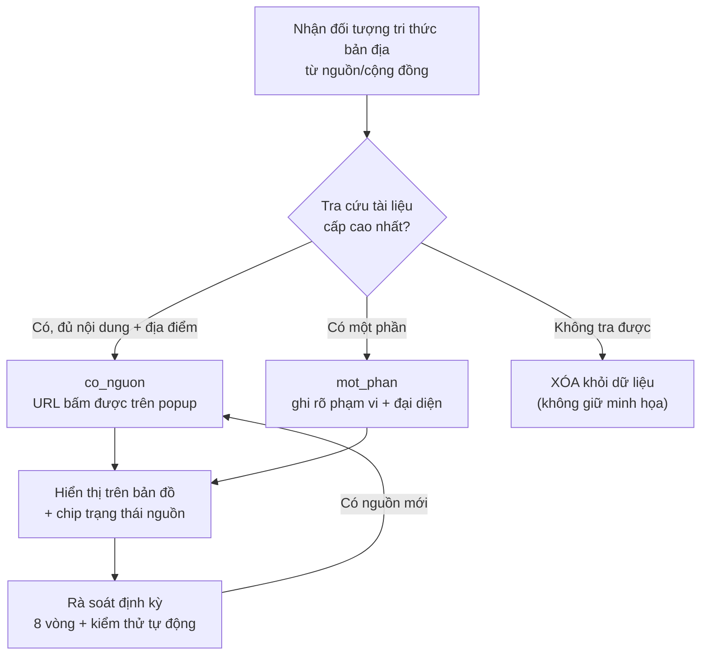

**Hình 2.** Quy trình truy thực nguồn — sơ đồ dòng.

### 4.3. Kiến trúc hệ thống

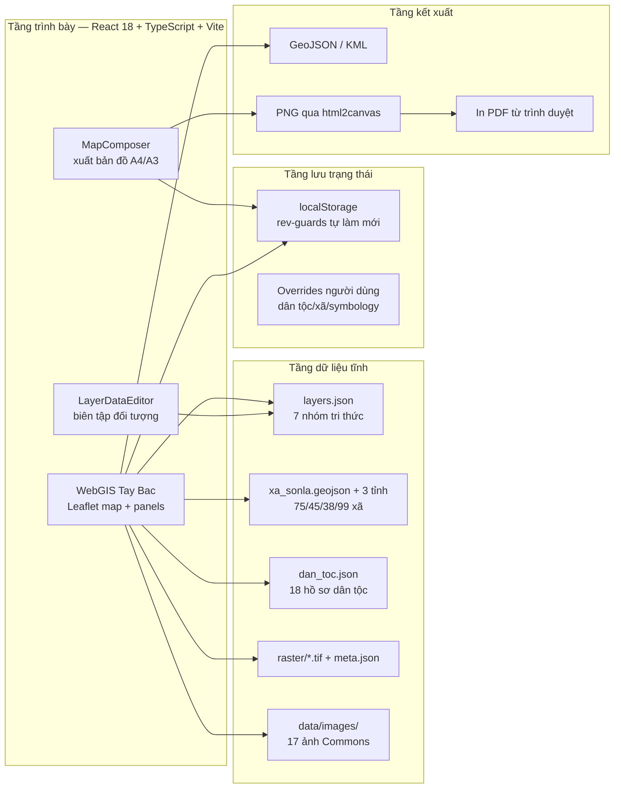

**Hình 3.** Kiến trúc hệ thống 4 tầng.

**Bảng 4. Công nghệ triển khai**

| Thành phần | Lựa chọn | Lý do |
|---|---|---|
| Framework UI | React 18 + TypeScript | Kiểu mạnh, bảo trì dễ |
| Bundler | Vite 7 | Khởi động/build nhanh |
| Thư viện bản đồ | Leaflet 1.9 | Nhẹ, plugin phong phú, mobile tốt |
| Dữ liệu | GeoJSON + JSON tĩnh | Triển khai đơn giản, dễ kiểm định/khác biệt hóa git |
| Biểu đồ | SVG nội tuyến (biểu đồ tròn cấp xã) | Không phụ thuộc thư viện ngoài |
| Xuất bản đồ | html2canvas + composer kéo–thả | Chụp render Leaflet thành ảnh nhúng khung giấy |
| Kiểm thử | Playwright (Chrome channel) | Kiểm thử hồi quy DOM + toạ độ tự động |
| Package manager | pnpm workspace | Mono-repo gọn |

### 4.4. Quy tắc chú giải thích ứng — đóng góp kỹ thuật

**Vấn đề.** Chú giải phải giải thích *mọi ký hiệu hiện diện trên bản đồ* (tinh thần QCVN 80 [6]). Với dữ liệu liên tỉnh và cơ chế "Chỉ khu vực chọn" (mặt nạ trắng che ngoài vùng chọn), hai lỗi thường gặp: (a) chú giải liệt kê loại rừng/loại công trình không có trong khung nhìn; (b) sau khi `fitBounds` với padding, khung nhìn vượt ranh tỉnh đang chọn khiến ký hiệu ngoài tỉnh (bị mặt nạ che) vẫn lọt vào điều kiện lọc theo khung nhìn.

**Giải pháp.** Ký hiệu được đưa vào chú giải khi và chỉ khi:

```
visible(feature) ⇔ bbox(feature) ∩ viewport(map) ∩ region(mask) ≠ ∅
```

với `region` = bbox của các xã được mặt nạ giữ lại (cùng tập xã với lớp mặt nạ trắng); khi tắt mặt nạ, `region = ⊤` (chỉ theo khung nhìn).

```text
// pseudo-code (thực thi trong WebGIS goc.tsx)
region ← selectedAreaOnly ∧ selectedProvince
          ? unionBBox(wards in selectedWardIds or allProvinceWards) : ∅

for each legendGroup in {forests, irrigation, VAC, medicinal, rivers, custom}:
    rows ← ∅
    for each feature in group:
        bb ← bbox(feature)                    // [lng,lat] cho polygon/polyline; point cho điểm
        if bb ∩ mapBounds ∩ region ≠ ∅:
            rows.add(kind(feature))
    emit legend section with rows (hide section if rows = ∅)
```

Hai memo React (`legendRegionBBox`, `legendInViewKinds`) tính lại khi có sự kiện `moveend/zoomend` (debounce 450 ms) hoặc khi đổi vùng chọn; composer dùng chung một hàm `featureVisible` để chú giải xuất bản khớp từng dòng với chú giải giao diện chính.

**Kết quả kiểm chứng.** Kiểm thử Playwright tự đo khung nhìn bằng toạ độ bốn mép bản đồ (thanh hiển thị toạ độ chuột), tính kỳ vọng **bằng đúng công thức bbox** với dung sai ±0,03°: 18/18 kiểm tra đạt, gồm bẫy xác nhận "khung nhìn fit Sơn La vẫn lọt polygon KBVCQ Mường Phăng nhưng chú giải không hiện" và "tắt mặt nạ → đủ 3 loại rừng theo khung nhìn".

### 4.5. Mô hình hóa tri thức bản địa

**Hình 4 — [cần bổ sung: sơ đồ ERD / mô hình dữ liệu].** *Gợi ý: vẽ bằng dbdiagram.io hoặc draw.io gồm các thực thể `Ward` (ma_xa, dan_so, dtich_km2, dan_toc[], dac_diem, …), `EthnicGroup` (id, ten, mo_ta, tri_thuc[], anh, nguon[]), `Village` (ten, ma_xa FK, mo_ta, anh), `CustomaryZone` (ma_xa FK, loai, mo_ta), `LayerFeature` (id, loai, coords, trang_thai, nguon[]), `SeasonalCalendar`, `TransectDiagram`.*

Cấu trúc tri thức theo xã bao gồm: (i) **cơ cấu dân tộc** (mảng % theo dân tộc, không bao giờ bị bóp về 100% giả tạo — phần thiếu được hiển thị trung thực là "Dân tộc khác" bằng phép trừ chính xác); (ii) **đặc điểm địa bàn** ≤350 ký tự kèm nguồn; (iii) **bản làng tiêu biểu** và **luật tục cộng đồng** ghép theo mã xã; (iv) **tri thức dân tộc** đa chủ đề (nông nghiệp, lễ hội, nghề, ẩm thực) kèm **nông lịch** và **luật đồ mặt cắt** cho từng dân tộc; (v) **ảnh dân tộc** từ Wikimedia Commons có ghi công giấy phép.

### 4.6. Phương pháp phát triển có hỗ trợ bởi trí tuệ nhân tạo

Dự án được phát triển theo quy trình **AI-assisted software engineering** với hai trợ lý lập trình: **Replit Agent** (tạo dự án, sinh mã nhánh lớn) và **opencode** (điều hướng mã nguồn, sửa đổi có mục tiêu, chạy lệnh kiểm định). Vai trò của con người là **trọng số quyết định cuối** đối với cả *mã* và *dữ liệu*.

**Bảng 5. Vòng lặp phát triển 5 bước**

| Bước | Hoạt động | Công cụ | "Chất chặn" (gate) |
|---|---|---|---|
| 1 | Mô tả yêu cầu chức năng/ngữ nghiệp bằng ngôn ngữ tự nhiên | Người | Rõ ràng, có tiêu chí nghiệm thu |
| 2 | Sinh/sửa mã, cấu trúc dữ liệu | Replit Agent / opencode | — |
| 3 | Kiểm định tĩnh + biên dịch | `tsc --noE0mit`, `vite build` | 0 lỗi |
| 4 | Kiểm thử hồi quy trình duyệt | Playwright harness (đo DOM + toạ độ) | 100% PASS |
| 5 | **Đối chiếu nguồn dữ liệu** và phê duyệt | Người + tra cứu web/OGD | Số liệu có nguồn hoặc bị xóa |

Đặc biệt, **nguyên tắc "không bịa số"** được thực thi ở bước 5: mọi con số do AI tổng hợp đều phải truy ngược được về URL/tài liệu; không đạt yêu cầu thì bị xóa. Tám vòng rà soát dữ liệu (ghi trong tài liệu nội bộ *RA_SOAT_DU_LIEU_VA_NGUON_THAM_KHAO.md*) là sản phẩm trực tiếp của quy trình này. Kiểm thử Playwright đóng vai trò "kỳ thi" cho mọi thay đổi do AI sinh ra (xem Mục 4.7).

### 4.7. Kiểm chứng tự động

**Bảng 6. Các đợt kiểm thử hồi quy tự động (Playwright)**

| Đợt | Phạm vi | Kết quả |
|---|---|---|
| Rà soát lớp minh họa cũ + panel (vòng 4) | 15 kiểm tra trạng thái dữ liệu/panel | 15/15 PASS |
| Khung composer đúng tỉ lệ khổ giấy | 11 kiểm tra (A4 ngang/đứng, migration bản nháp) | 11/11 PASS |
| Chú giải theo khung nhìn | 12 kiểm tra (3 giai đoạn zoom, parity composer) | 12/12 PASS |
| Chú giải giao vùng chọn (vòng 8) | 18 kiểm tra gồm 2 "bẫy" xác nhận | ALL PASS |
| Parity chú giải chính ↔ composer | So khớp từng dòng, đúng thứ tự | PASS |
| Sơ đồ dân tộc + tổng biểu đồ tròn | Tổng % = 100,01 (làm tròn) | PASS |
| Biên dịch + kiểm kiểu | `tsc` + `vite build` | PASS |

---

## 5. KẾT QUẢ

### 5.1. Kết quả số hóa và kiểm định dữ liệu

**Bảng 7. Tồn kho đối tượng tri thức sau 8 vòng rà soát (toàn bộ `co_nguon`)**

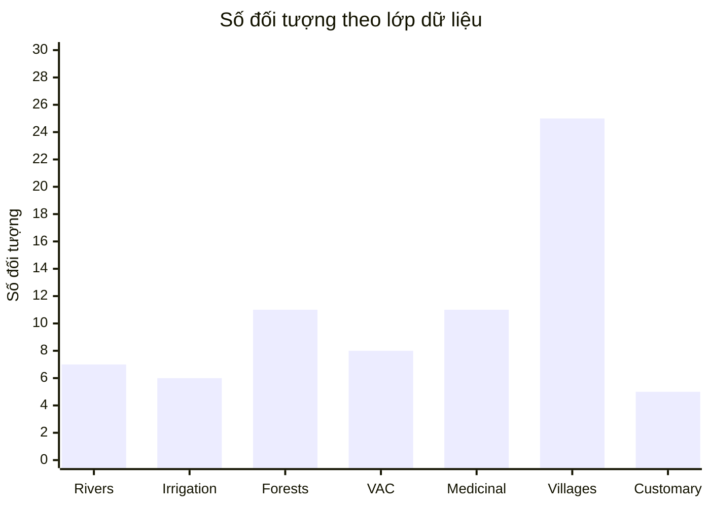

**Hình 5.** Biểu đồ cột số đối tượng 7 nhóm lớp tri thức (tính từ `layers.json`).

Biên tập dân tộc 75 xã sau rà soát: **7 `co_nguon`** (Sốp Cộp, Mường Chiên, Tà Xùa, Tân Phong, Suối Tọ, Ngọc Chiến, Mường Khiêng — có % cấp xã trong nguồn), **49 `mot_phan`** (áp % một phần cho đúng phạm vi xã), **19 `du_doan`** (giữ mẫu huyện, ghi rõ trong ghi chú nguồn).

**Bảng 8. Cơ cấu dân tộc toàn tỉnh Sơn La — ước tính từ dân số 75 xã × % (dự án) đối chiếu TCTD 2019**

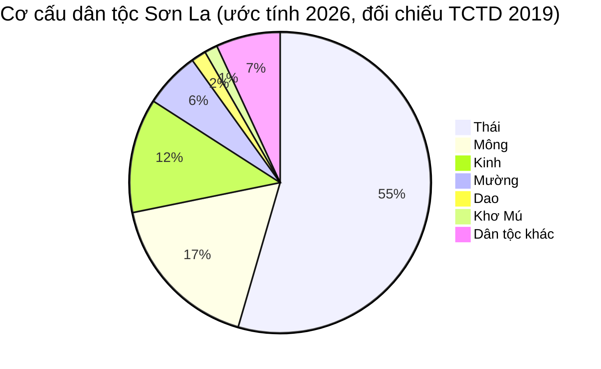

**Hình 6.** Biểu đồ tròn cơ cấu dân tộc (số liệu ước tính từ dữ liệu dự án; TCTD 2019 cấp tỉnh: Thái 53,6% · Mông 16,1% · Kinh 16,3% — sai khác do kỳ số liệu và 15 xã thiếu % nhóm nhỏ, được ghi nhận trung thực, không tự hiệu chỉnh).

Minh họa dữ liệu có nguồn cấp xã (đối chiếu từng số với Cổng TTĐT xã):

**Bảng 9. Cơ cấu dân tộc xã Sốp Cộp (`co_nguon`)**

| Dân tộc | Tỷ lệ (%) |
|---|---:|
| Thái | 63,57 |
| Kinh | 22,35 |
| Mông | 7,85 |
| Khơ Mú | 3,92 |
| Lào | 1,43 |
| Các dân tộc khác | 0,88 |
| **Tổng** | **100,00** |

### 5.2. Hệ thống vận hành

**Hình 7.** Giao diện chính — bản đồ tổng quan 4 tỉnh với lớp sông suối (OSM) và phân vùng rừng (WDPA).
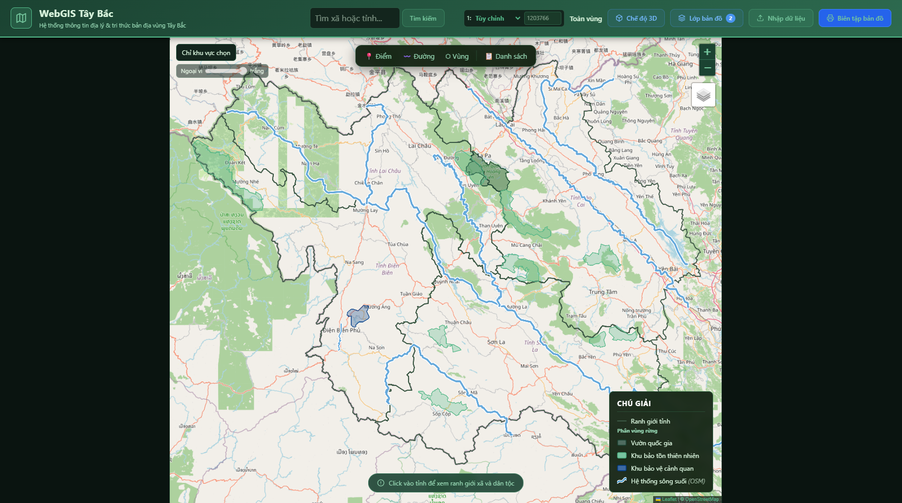

**Hình 8.** Choropleth mật độ dân số 7 bậc tại Sơn La; mặt nạ "Chỉ khu vực chọn" che ngoại vi; chú giải chỉ hiện **"Khu bảo tồn thiên nhiên"** trong nhóm rừng — đúng loại rừng thực sự có trong tỉnh (minh họa trực tiếp quy tắc Mục 4.4); khối thống kê tỉnh kèm dòng nguồn.
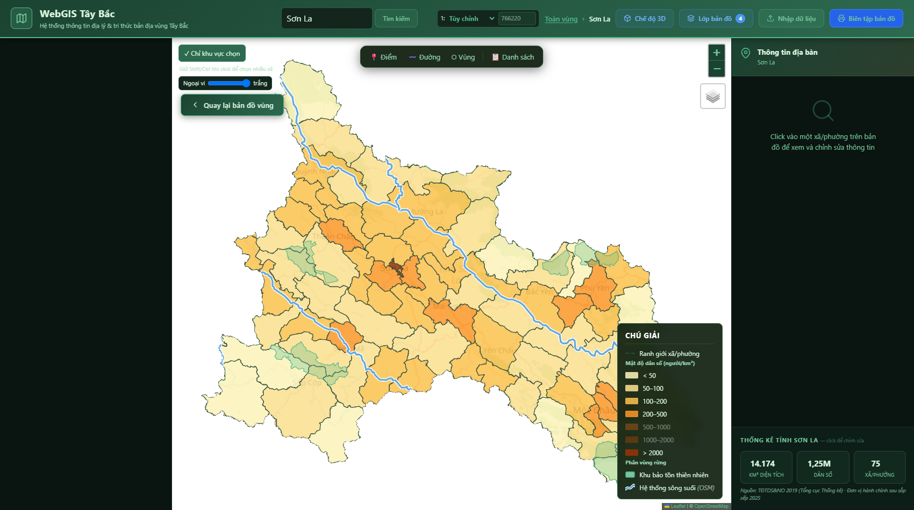

**Hình 9.** Biểu đồ tròn cơ cấu dân tộc 75 xã phủ toàn tỉnh, mỗi xã một biểu đồ tròn riêng; chú giải dân tộc lập trình hóa theo 12 nhóm + "Dân tộc khác".
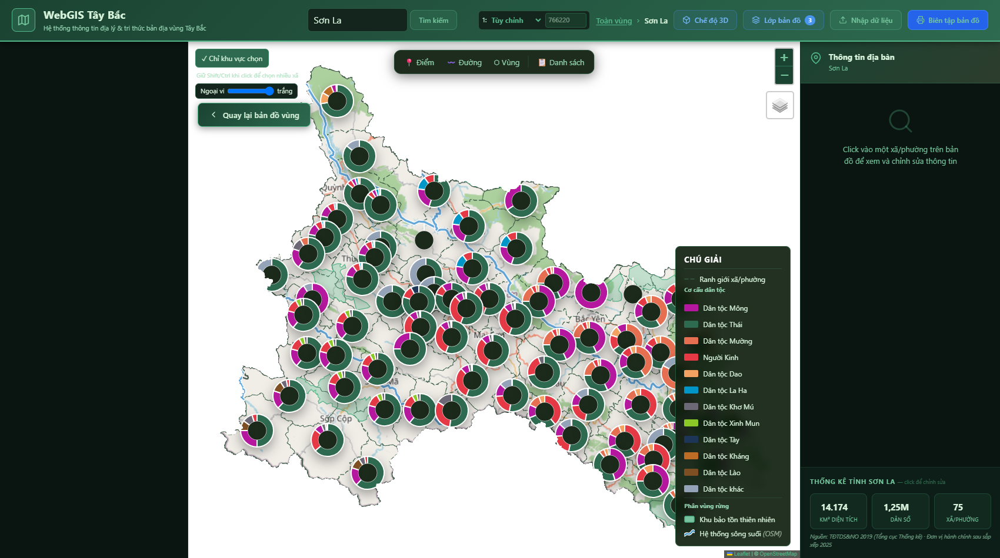

**Hình 10.** Lớp tri thức bản địa: thủy lợi truyền thống (Mương·Lái, Cọn — nhóm Phai/Lịn bị loại vì nằm ngoài Sơn La), phân vùng rừng, mô hình VAC, cây thuốc, sông suối — chú giải giao đồng thời khung nhìn và vùng chọn.
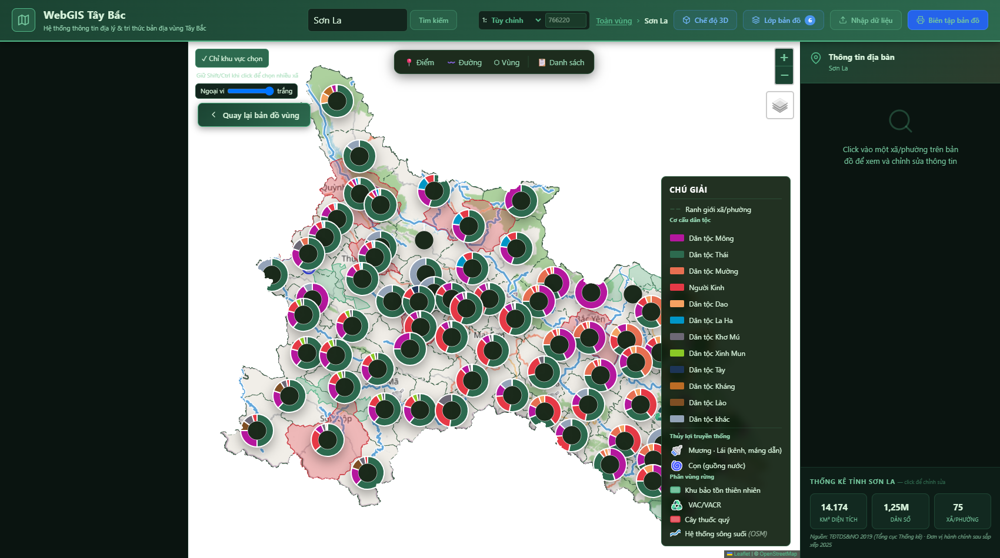

**Hình 11.** Trình bày & xuất bản đồ (MapComposer): khung bản đồ đúng tỉ lệ khổ giấy A4 ngang (1,414), ảnh bản đồ được đồng bộ bằng html2canvas, chú giải đặt **ngoài khung** theo tinh thần QCVN 80, bảng thông tin tỉ lệ/độ rộng/độ phân giải.
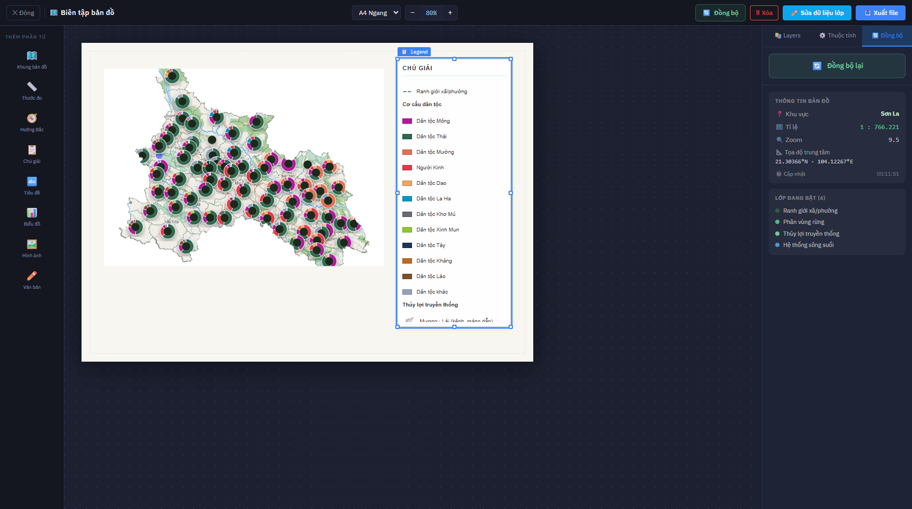

**Hình 12.** Panel "Thông tin địa bàn" cấp xã (minh họa xã Bản Liền, Bắc Hà): banner ảnh dân tộc chủ đạo kèm ghi công Wikimedia Commons, số liệu dân số/diện tích/mật độ kèm nguồn, khối "Bản làng tiêu biểu" với mô tả chè Shan tuyết hữu cơ OCOP — dữ liệu tri thức ghép theo mã xã.
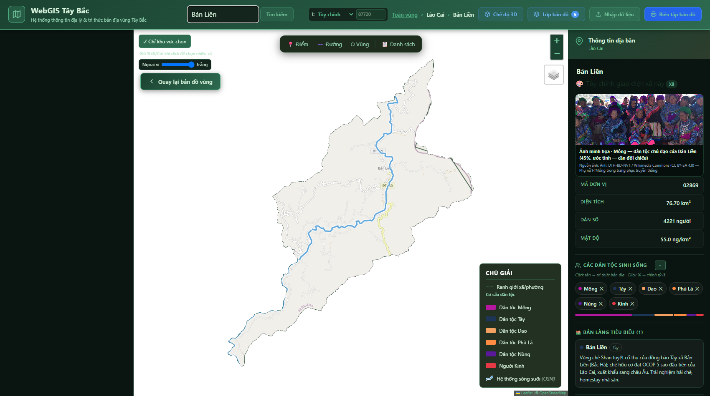

### 5.3. Minh họa liên kết tri thức bản địa – kinh tế tuần hoàn

**Bảng 10. Chuỗi tri thức – tài nguyên – kinh tế tuần hoàn (trích nguồn trong hệ thống)**

| Chuỗi giá trị | Thành phần không gian trong hệ thống | Bằng chứng nguồn trong hệ thống |
|---|---|---|
| **Dược liệu dưới tán rừng** | 11 polygon vùng dược liệu; 11 khu bảo tồn (WDPA) | KBTTN Mường La >48 ha chu kỳ 1 (thongtindoingoai.sonla.gov.vn, 10/2026); Sơn La 16.145 ha dược liệu năm 2025 (nc23.cnnd.vn, 11/2025) |
| **Thảo quả & VAC phối hợp** | 8 mô hình VAC; điểm cọn/mương | Mô hình anh Hàng A Cơ (Khun Há): 5 ha thảo quả dưới tán (6.000 gốc, 200–300 triệu đồng/năm) + ao cá gần 3.000 m², tổng thu >500 triệu đồng/năm (baotintuc.vn, 2018) |
| **Chè hữu cơ chuỗi khép kín** | Luật tục Bản Liền + bản làng + polygon xã | Quy ước bản phạt hành vi phun thuốc; chứng nhận EU/USDA 9/2007; HTX 310 thành viên; OCOP 5 sao (sanphamvungmien.vn/Bộ Công Thương, 2025) |
| **Nước tưới cộng đồng (muang-fai)** | 6 công trình thủy lợi + lịch tu sửa | Chiềng Khoong: 25 công trình (18 kiên cố, 7 gỗ–đá), ~20 km mương, 21 tổ thủy nông, tưới 245 ha (songma.sonla.gov.vn, 2022); muang-fai Chiềng Khôi (Neef et al., 2006) |
| **Du lịch cộng đồng – cảnh quan** | Cọn nước Nậm É; 25 bản làng có ảnh/mô tả | "Giữ nhịp quay cọn nước bên dòng Nậm É" (baosonla.vn, 2026) |
| **Bảo vệ đầu nguồn bằng luật tục** | 5 luật tục; 11 khu bảo tồn | Rừng thiêng Hà Nhì Y Tý (cúng rừng tháng Giêng, mở cửa rừng 1 ngày/tuần — baolaocai.vn, 2016/2020) |

Sơ đồ tư duy ra chính sách:

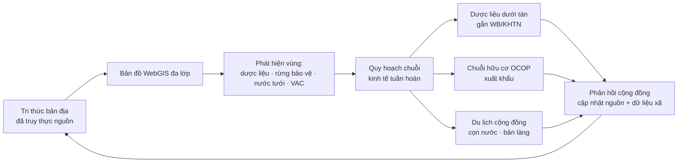

**Hình 13.** Vòng phản hồi dữ liệu phục vụ kinh tế tuần hoàn.

### 5.4. Tuân thủ chuẩn chú giải bản đồ

Hệ thống áp dụng phân cấp ký hiệu địa giới (tỉnh nét liền weight 1,9; xã nét đứt `6,4` weight 1,0 — tham chiếu mô tả kỹ thuật bản đồ địa hình/hành chính theo QCVN 80 [6]), thứ tự chú giải cố định: ranh giới → mật độ → cơ cấu dân tộc → thủy lợi → rừng → VAC → cây thuốc → lớp tùy chỉnh → đối tượng vẽ tay → sông suối; chú giải composer luôn **ngoài khung bản đồ**; hàng chú giải ẩn/hiện tự động theo quy tắc giao ba.

---

## 6. THẢO LUẬN

### 6.1. Đánh giá so với mục tiêu nghiên cứu

Cả ba câu hỏi nghiên cứu đều được trả lời thực chứng: RQ1 bằng khung truy thực nguồn + chính sách xóa dữ liệu không nguồn (11/30 mục); RQ2 bằng quy tắc giao ba và 18/18 kiểm thử; RQ3 bằng mô tả quy trình 5 bước và 8 vòng rà soát.

### 6.2. Giới hạn

1. **Tọa độ điểm đại diện:** nhiều điểm thủy lợi/VAC dùng centroid hành chính GADM 4.1 do OSM chưa có ranh giới xã phù hợp thời điểm tra cứu — đã ghi rõ "mang tính đại diện" trong mô tả; cần kiểm nghiệm thực địa.
2. **Dân tộc 19 xã còn ở mức `du_doan`:** Tổng điều tra công bố tới cấp huyện; chờ nguồn cấp xã mới — hệ thống hiển thị nhãn ước tính thay vì suy đoán phân bổ.
3. **Raster chuyên đề là mô hình ước lượng** (Open-Meteo/SRTM), không phải quan trắc trực tiếp — đã ghi trên chú giải.
4. **Chưa có khảo sát người dùng định lượng:** *\[cần bổ sung: N người dùng (UBND huyện, phòng TN&MT, nhà nghiên cứu văn hóa), chỉ số SUS/UEQ, thời gian hoàn thành tác vụ]\*.*
5. **Phụ thuộc trình duyệt cho xuất bản đồ:** html2canvas có giới hạn với một số lớp Leaflet; phương án thay thế là render server-side (headless Chrome/Puppeteer) đang hướng tới.
6. **AI-assisted development:** mã do AI sinh đòi hỏi kiểm định chặt (typecheck/build/Playwright) và review người ở mọi commit; hệ thống kiểm định kép là bắt buộc, không thể bỏ — kinh nghiệm này cần được tổng quát hóa thận trọng.

### 6.3. Hướng phát triển

- Mở rộng dữ liệu chi tiết cho Điện Biên, Lai Châu, Lào Cai (hệ thống đã hỗ trợ đa tỉnh).
- Tích hợp ảnh vệ tinh thời vụ (Sentinel-2) cho giám sát thảm thực vật dược liệu.
- Cổng đóng góp dữ liệu cộng đồng (crowdsourcing) có phê duyệt theo dòng trạng thái nguồn sẵn có.
- Xuất bản đồ server-side và tích hợp in ấn PDF trực tiếp.
- Kiểm định thực địa có tham gia (participatory GIS) cùng già làng/trưởng bản cho các tọa độ nhạy cảm (vị trí cây thuốc quý cần đồng thuận cộng đồng).

---

## 7. KẾT LUẬN

Bài báo đã trình bày một hệ thống WebGIS cho lập bản đồ tri thức bản địa tại Sơn La với ba đóng góp cốt lõi: (1) **khung truy thực nguồn hiển thị** biến nguyên tắc "không bịa số" thành cơ chế kỹ thuật bắt buộc; (2) **quy tắc chú giải thích ứng theo giao ba** bbox–khung nhìn–vùng chọn, đảm bảo chú giải chỉ giải thích những ký hiệu thật sự hiện diện; (3) **quy trình phát triển có hỗ trợ AI** với các cổng kiểm định tự động. Hệ thống hiện diện hóa 63 đối tượng tri thức đã kiểm định cùng dữ liệu 75 xã của Sơn La, cung cấp nền tảng dữ liệu không gian tin cậy cho quản lý tài nguyên và phát triển các chuỗi kinh tế tuần hoàn (dược liệu dưới tán, chè hữu cơ, VAC, du lịch cộng đồng) — có thể nhân rộng cho toàn vùng Tây Bắc.

---

## LỜI CẢM ƠN

Tác giả cảm ơn cộng đồng các dân tộc Sơn La đã lưu giữ và chia sẻ tri thức bản địa; cảm ơn Tổng cục Thống kê, Cổng dữ liệu mở tỉnh Sơn La, UNEP-WCMC/IUCN (WDPA), cộng đồng OpenStreetMap và Wikimedia Commons đã cung cấp dữ liệu mở. Tác giả ghi nhận việc phát triển hệ thống đã sử dụng các công cụ hỗ trợ lập trình bằng trí tuệ nhân tạo — **Replit Agent** và **opencode** — theo quy trình "sinh mã – kiểm định tự động – đối chiếu nguồn – con người phê duyệt", trong đó mọi số liệu khoa học đều do con người đối chiếu và chịu trách nhiệm cuối cùng.

---

## DANH MỤC TÀI LIỆU THAM KHẢO

*(Tham chiếu Harvard; các nguồn [1]–[19] đã được sử dụng trong tài liệu rà soát nội bộ của dự án, độ tin cậy phân hạng A–D theo thang: A = cơ quan thống kê/nhà nước, B = tạp chí khoa học, C = báo chính thống, D = nguồn thứ cấp — chỉ đối chiếu.)*

[1] Tổng cục Thống kê (2020). *Kết quả Tổng điều tra dân số và nhà ở năm 2019*. Hà Nội: Statistical Publishing House. (Truy cập: https://www.nso.gov.vn)

[2] Tổng cục Thống kê (2020). *Đặc trưng cơ bản của 53 dân tộc thiểu số năm 2019*. Hà Nội. https://www.nso.gov.vn/wp-content/uploads/2020/07/Dac-trung-53-dan-toc-thieu-so-2019_ban-in.pdf

[3] Chính phủ Việt Nam (2024). *Chương trình hành động về tăng cường năng lực tiếp cận công nghiệp hóa, hiện đại hóa lần thứ tư... gắn với kinh tế tuần hoàn, kinh tế xanh* — *(cần bổ sung chính xác số hiệu/ký hiệu văn bản khi đăng bài)*. Hà Nội.

[4] Quốc hội / Ủy ban Thường vụ Quốc hội (2025). *Nghị quyết số 202/2025/QH15* và các Nghị quyết sắp xếp đơn vị hành chính cấp tỉnh, cấp huyện, cấp xã hiệu lực 01/7/2025 (NQ 1670, 1673, 1681, 1661/NQ-UBTVQH15).

[5] Sở Khoa học và Công nghệ tỉnh Sơn La. *Cổng dữ liệu mở tỉnh Sơn La — Dữ liệu địa giới hành chính & văn hóa các dân tộc Việt Nam*. https://data.sonla.gov.vn (truy cập 03/9/2026).

[6] Bộ Tài nguyên và Môi trường. *QCVN 80:2024/BTNMT — Quy chuẩn kỹ thuật quốc gia về ... bản đồ* *(cần đối chiếu chính xác tên và số hiệu văn bản thay thế QCVN 80:2014/BTNMT khi đăng bài)*.

[7] UNEP-WCMC & IUCN (2024). *World Database on Protected Areas (WDPA)*. Cambridge, UK. https://www.protectedplanet.net

[8] OpenStreetMap contributors. *OpenStreetMap Open Database License (ODbL)*. https://www.openstreetmap.org/copyright

[9] GADM Consortium (2024). *GADM database of Global Administrative Areas, version 4.1*. https://gadm.org

[10] Neef, R. và cộng sự (2006). *Property rights and sustainability of traditional irrigation systems in northwestern Vietnam (muang-fai, Yên Châu, Sơn La)*. Indiana University, Digital Library of the Commons. http://hdl.handle.net/10535/560

[11] Viện Dân tộc học. Tạp chí Dân tộc học — các bài về tri thức dân gian và hệ thống tưới truyền thống người Thái. https://vjol.info.vn/tapchiviendantochoc

[12] Trường Đại học Tây Bắc (2021). *Bảo vệ rừng của người Thái tỉnh Sơn La* (các loại rừng theo tập quán: rừng ma, rừng cấm, rừng cúng). Tạp chí Khoa học & Công nghệ — https://fss.utb.edu.vn/wp-content/uploads/2021/06/1-1.pdf

[13] Báo Lào Cai (2016, 2020). *Bảo vệ rừng gắn với bảo tồn văn hóa*; *Lễ hội cầu mùa của người Hà Nhì*. https://baolaocai.vn

[14] Báo Sơn La (2026). *Giữ nhịp quay cọn nước bên dòng Nậm É*. https://baosonla.vn; Bảo tàng Văn hóa Các dân tộc Việt Nam — hệ thống dẫn thủy nhập điền của nhóm cư dân Tây–Thái. http://mcve.org.vn

[15] sanphamvungmien.vn, Bộ Công Thương (2025). *Chè Shan tuyết Bản Liền từ gốc cổ thụ đến thương hiệu hữu cơ quốc tế*. https://sanphamvungmien.vn

[16] nc23.cnnd.vn (2025). *Sơn La: phát triển vùng dược liệu 16.145 ha*; thongtindoingoai.sonla.gov.vn (2026) — *KBTTN Mường La: dược liệu dưới tán rừng >48 ha chu kỳ 1*.

[17] Goodchild, M. F. (2007). Citizens as sensors: the world of voluntary geography. *GeoJournal*, 69(4), 211–221.

[18] UBND huyện Sông Mã (2022). *Chiềng Khoong đảm bảo nguồn nước cho lúa xuân* (25 công trình thủy lợi, 245 ha). https://songma.sonla.gov.vn

[19] Phùng Như Giang và cộng sự (2023). *Kết quả chọn cây trội thảo quả tại Yên Bái và Lào Cai*. Tạp chí Khoa học Lâm nghiệp, số 4/2023. https://vafs.gov.vn

[20] baotintuc.vn (2018). *Mô hình phát triển kinh tế hiệu quả của người Mông huyện Tam Đường, Lai Châu* (mô hình VAC + thảo quả Khun Há).

[21] baosonla.org.vn (2020). *Làm giàu từ mô hình VAC* — bản Tà Lọt, xã Tà Lại, Mộc Châu.

[22] vietnamnews.vn (2020). *Mông ethnic people celebrate new year* (thời điểm Tết Mông/Nào Pê Chầu).

[23] Báo Văn hóa. *Lễ hội Gầu Tào là di sản văn hóa phi vật thể quốc gia của người Mông ở Yên Bái*; *Xên bản, xên mường — phong tục độc đáo của người Thái ở Pắc Ngà*.

[24] NASA JPL (2013). *Shuttle Radar Topography Mission (SRTM) Digital Elevation Model* — dữ liệu nền độ cao; Open-Meteo (mô hình khí hậu tái phân tích, dùng cho lớp nhiệt/mưa — **mô hình ước lượng, không phải quan trắc**).

[25] Wikimedia Commons contributors (các ảnh dân tộc và địa danh, giấy phép CC BY-SA / CC0 — danh mục chi tiết trong `NGUON_ANH.md` của dự án).

[26] React Team. *React — A JavaScript library for user interfaces*. https://react.dev

[27] Leaflet Contributors. *Leaflet — a open-source JavaScript library for mobile-friendly interactive maps*. https://leafletjs.com

[28] Microsoft (Playwright). *Playwright: reliable end-to-end testing for modern web apps*. https://playwright.dev

*(Lưu ý biên tập: [3] và [6] cần đối chiếu chính xác số hiệu văn bản trước khi đăng; [17] dùng cho nền tảng lý luận — bổ sung nếu cần tăng độ dày học thuật.)*

---

## PHỤ LỤC A — DANH MỤC HÌNH ẢNH CẦN BỔ SUNG

| Mã hình | Nội dung cần bổ sung | Gợi ý thực hiện |
|---|---|---|
| Hình 1 | Vị trí Sơn La + phân bố 75 xã trên nền địa hình | QGIS: `tinh.geojson` + `xa_sonla.geojson` + SRTM; xuất 300 dpi |
| Hình 4 | Sơ đồ ERD / mô hình thực thể–quan hệ đầy đủ | dbdiagram.io hoặc draw.io |
| Hình 14 | Ảnh hiện trường: cọn nước Nậm É, muang-fai Chiềng Khôi, ruộng/dưới tán thảo quả | Khảo sát thực địa hoặc xin phép báo đã dẫn nguồn |
| Hình 15 | Ảnh khảo sát người dùng hệ thống (UBND huyện, phòng TN&MT) | Chụp có sự đồng ý khi triển khai thử nghiệm |
| Hình 16 | Bản in PDF mẫu từ composer (A4 ngang, có tiêu đề, tỉ lệ 1:766.221, hướng Bắc) | Nút "Xuất file" → in PDF |
| Hình 17 | Sơ đồ quy trình kiểm thử Playwright (harness đo DOM + toạ độ) | draw.io, kèm ảnh cắt màn hình console PASS |

**Tệp hình đã có sẵn (kèm bài):** `figures/fig01_tong_quan_4_tinh.png`, `fig02_mat_do_dan_so_son_la.png`, `fig03_co_cau_dan_toc.png`, `fig04_tri_thuc_ban_dia_on_dinh.png`, `fig05_composer_xuat_ban_do.png`, `fig06_thong_tin_xa_ban_lien.png` (ảnh chụp thật từ hệ thống đang vận hành, ngày 17/10/2026).

## PHỤ LỤC B — BẢNG MÃ/TRƯỜNG DỮ LIỆU CHÍNH

| Trường | Kiểu | Vai trò |
|---|---|---|
| `trang_thai` | `co_nguon` \| `mot_phan` \| `du_doan` | Trạng thái truy thực nguồn (bắt buộc) |
| `nguon` | string[] (URL) | Nguồn kiểm chứng, hiển thị bấm được |
| `dan_toc_trang_thai` | `co_nguon` \| `mot_phan` \| `du_doan` | Mức tin cậy số liệu dân tộc cấp xã |
| `loai` (forests) | `vqg` \| `kbttn` \| `kbvcq` \| `rung_dac_dung` | Phân loại rừng theo WDPA/địa danh |
| `loai` (irrigation) | `phai` \| `muong` \| `lin` \| `lai` \| `con` | Loại công trình thủy lợi truyền thống |
| `ma_xa` | string | Khóa ghép bản làng/luật tục ↔ xã |
| `dac_diem`, `dac_diem_nguon`, `dac_diem_trang_thai` | string / URL[] / enum | Đặc điểm địa bàn kèm nguồn |
| `dan_so`, `dtich_km2`, `matdo_km2`, `dtts_so` | number | Thống kê theo Cổng dữ liệu mở Sơn La |
