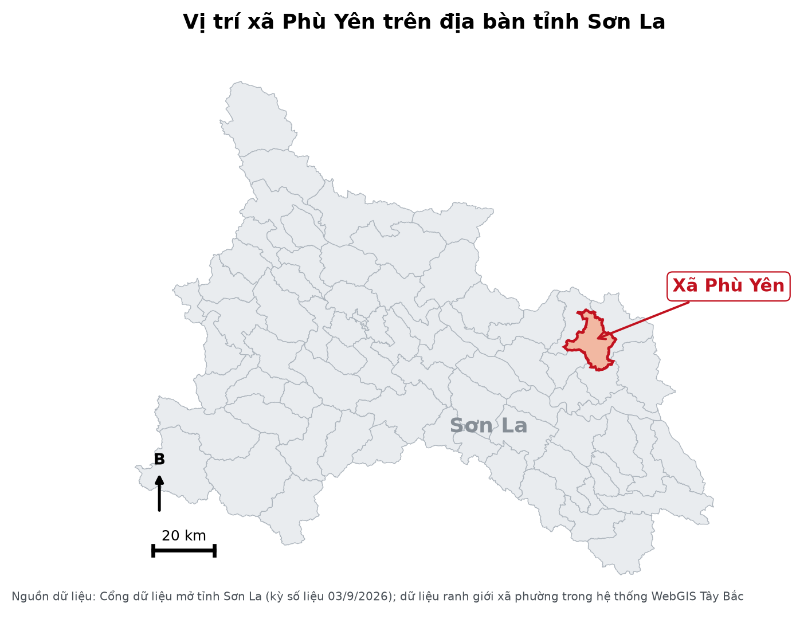
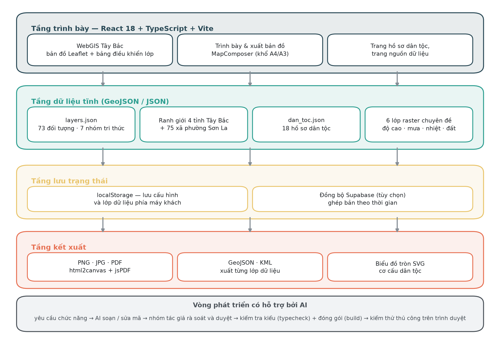
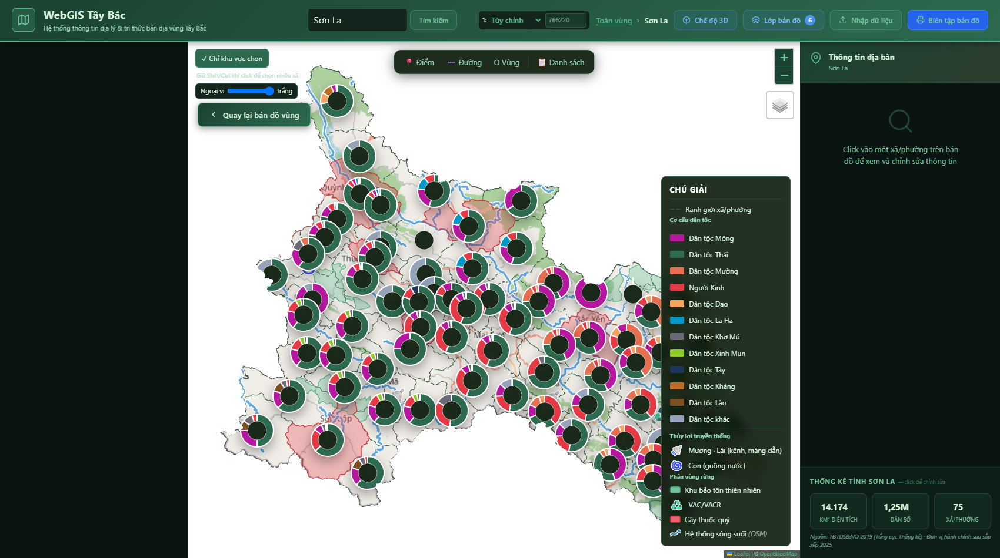
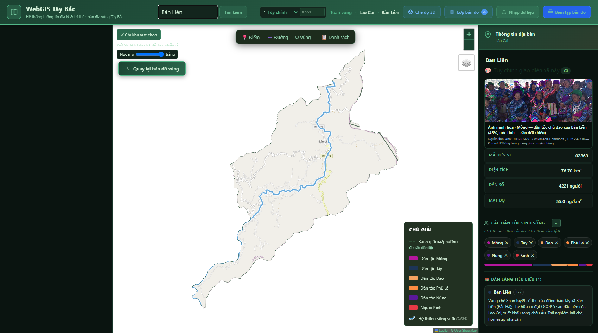
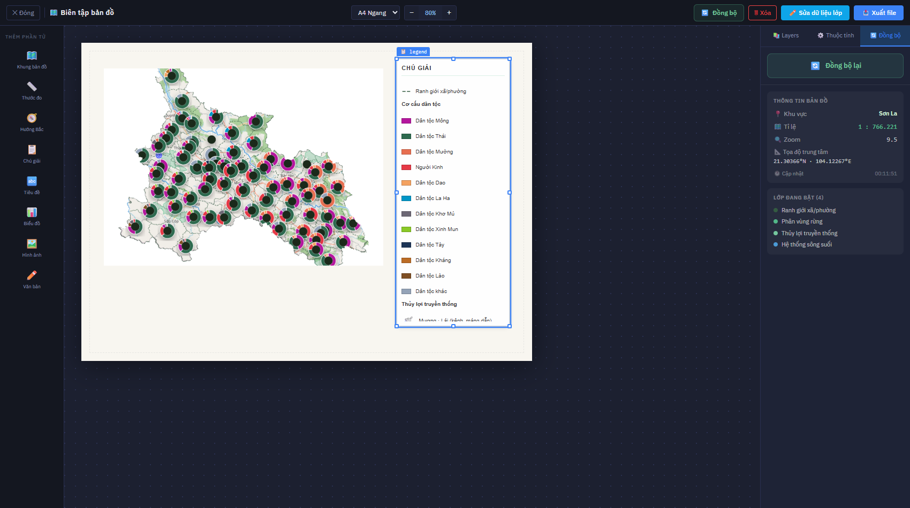

# BẢN ĐỒ TRI THỨC BẢN ĐỊA TRÊN NỀN TẢNG WEBGIS TÂY BẮC PHỤC VỤ QUẢN LÍ TÀI NGUYÊN CỦA DÂN TỘC THÁI TẠI XÃ PHÙ YÊN, TỈNH SƠN LA

**BUILDING AN INDIGENOUS KNOWLEDGE MAP ON WEBGIS TAY BAC PLATFORM FOR NATURAL RESOURCE MANAGEMENT OF THE THAI ETHNIC GROUP IN PHU YEN COMMUNE, SON LA PROVINCE, VIETNAM**

Nguyễn Thị Hồng Nhung*, Hà Vi Lương Thảo, Hoàng Thu Chuyền, Bùi Thị Huyền Trang, Vàng A Páo · Trường Đại học Tây Bắc

*Lịch sử bài viết: Nhận bài: … · Chấp nhận đăng: … · Xuất bản: …*

---

## TÓM TẮT

Nghiên cứu xây dựng bản đồ tri thức bản địa trên nền tảng WebGIS Tây Bắc do nhóm tác giả phát triển bằng React, TypeScript, Leaflet và GeoJSON, với sự hỗ trợ của AI trong soạn thảo và sửa mã, nhằm phục vụ quản lí tài nguyên đất, nước, rừng của dân tộc Thái tại xã Phù Yên, tỉnh Sơn La. Khảo sát có chủ đích 28 người Thái cho thấy tri thức truyền thống vẫn còn hiện diện (25/28 người cho biết biện pháp quản lí đất bắt nguồn từ cha ông và luật tục; 26/28 người cho biết bản còn phân loại rừng theo phong tục) nhưng đang mai một, chủ yếu do lớp trẻ đi làm ăn xa và thiếu ghi chép, bản đồ. Cả 28 người cho rằng cần số hóa tri thức về đất thành bản đồ hướng dẫn; 23/27 người trả lời muốn dùng đồng thời bản đồ giấy và ứng dụng trên điện thoại. Hệ thống hiển thị các lớp dữ liệu GeoJSON, biểu đồ và cho phép xuất bản đồ ra PNG, JPG, PDF; mã nguồn được kiểm tra kiểu, đóng gói và kiểm thử thủ công sau mỗi lần chỉnh sửa. Hạn chế hiện tại gồm mẫu khảo sát nhỏ và phi xác suất, bản dựng chưa có phân quyền, dữ liệu chưa được kiểm chứng cùng cộng đồng và chưa đánh giá khả dụng. Kết quả mang tính đặc thù theo bối cảnh Phù Yên và không suy rộng cho mọi cộng đồng người Thái.

**Từ khóa:** WebGIS; Tri thức bản địa; Quản lí tài nguyên; Dân tộc Thái; Phù Yên; Sơn La

## ABSTRACT

This study builds an indigenous knowledge map on the WebGIS Tay Bac platform, developed by the authors with React, TypeScript, Leaflet and GeoJSON and with AI assistance in drafting and editing code, to support natural resource management of the Thai ethnic group in Phu Yen commune, Son La province, Vietnam. A purposive survey of 28 Thai respondents shows that traditional knowledge is still in use (25 of 28 reported that their land management practices come from their ancestors and customary law; 26 of 28 reported that villages still classify forests by custom) but is eroding, mainly because young people leave to work elsewhere and because the knowledge is not recorded or mapped. All 28 respondents considered it necessary or very necessary to digitize land knowledge into a guidance map, and 23 of 27 respondents wanted both a printed map and a mobile application. The system displays GeoJSON layers and charts and exports maps as PNG, JPG and PDF; the source code was type-checked, built and manually tested in the browser after each revision. Limitations include a small non-probability sample, no access control in the current build, no validation of the data with the community and no usability evaluation. The results are context-specific and should not be generalized to all Thai communities.

**Keywords:** WebGIS; Indigenous knowledge; Natural resource management; Thai ethnic group; Phu Yen; Son La

---

## 1. TÍNH CẤP THIẾT CỦA VẤN ĐỀ NGHIÊN CỨU

Tri thức bản địa (Indigenous Knowledge – IK), hay tri thức sinh thái truyền thống (Traditional Ecological Knowledge – TEK), là tập hợp hiểu biết, thực hành và niềm tin được cộng đồng tích lũy, truyền qua nhiều thế hệ về mối quan hệ giữa con người với môi trường [1]. Berkes và cs. [1] cho rằng TEK vận hành như một hệ quản lý thích ứng, trong đó thiết chế cộng đồng, điều cấm kỵ và không gian thiêng điều tiết việc khai thác tài nguyên; Salim và cs. [2] đã tổng quan có hệ thống các nghiên cứu về tác động của TEK đối với cộng đồng bản địa. Trong nghiên cứu này, tri thức bản địa được hiểu là một hệ thống quản trị gắn với xã hội, vận hành qua thực hành sinh thái, chuẩn mực văn hóa và quyết định tập thể của cộng đồng, chứ không chỉ là di sản văn hóa; cách tiếp cận này tương đồng với [13]. Ở Việt Nam, tri thức bản địa của người Dao ở Bắc Kạn trong thích ứng biến đổi khí hậu [3], hay của người Thái ở Sơn La trong sản xuất nông nghiệp – từ làm thủy lợi, làm đất, thời vụ đến tạo phân xanh và chăn nuôi [4] – đã được ghi nhận như nguồn lực có giá trị thực tiễn.

Tại xã Phù Yên, người Thái vẫn duy trì nhiều thực hành quản lí đất, nước, rừng theo kinh nghiệm cha ông và luật tục: cải tạo đất bằng phân chuồng, phân xanh và cho đất nghỉ, khai thác nước qua ống bương, máng gỗ, mương, phai, phân loại rừng theo phong tục (mục 3.1). Nhưng các thực hành này ít được ghi chép hoặc thể hiện trên bản đồ, nên dễ thất truyền khi lớp trẻ rời bản đi làm ăn xa. Ở góc độ phát triển bền vững, tri thức bản địa còn gắn với việc tái sử dụng và tuần hoàn vật chất trong sản xuất. Khái niệm kinh tế tuần hoàn đã được định nghĩa và thảo luận rộng rãi [5], [6]; một số nghiên cứu cho thấy các hệ thống bản địa chứa sẵn nguyên tắc tuần hoàn [7] và tri thức sinh thái truyền thống gắn với dịch vụ hệ sinh thái và sinh kế nông nghiệp [8]. Ở Việt Nam, Luật Bảo vệ môi trường 2020 [9] và Đề án phát triển kinh tế tuần hoàn [10] tạo khung pháp lý và chính sách cho hướng tiếp cận này.

Để giá trị của tri thức bản địa được phát huy cần gắn nó với không gian địa lý, và GIS có sự tham gia (PGIS/PPGIS) là hướng tiếp cận được áp dụng rộng rãi nhằm đưa tri thức địa phương vào quản lý thông tin không gian [11], [12]. Phan và cs. [13] khảo sát 200 hộ người Dao ở Lai Châu và ghi nhận hơn 80% người trả lời đồng ý rằng bảo vệ rừng thiêng và các thực hành sinh thái bản địa đóng góp cho bền vững môi trường, đồng thời đánh giá tích cực việc dùng GIS trong quy hoạch. Tuy nhiên, trong phạm vi các tài liệu chúng tôi tra cứu, các nghiên cứu về tri thức bản địa ở Tây Bắc chủ yếu mô tả tri thức bằng văn bản hoặc số liệu khảo sát [3], [4], [13]. Ngay trong [13], GIS chỉ được dùng để đặt kết quả khảo sát vào bối cảnh địa hình, sử dụng đất và phân bố dân cư; các tác giả chưa triển khai mô hình GIS có sự tham gia hay một nền tảng bản đồ cho cộng đồng sử dụng.

Cộng đồng, đặc biệt là người trẻ, cần được đưa vào quá trình lưu giữ tri thức này. Kết quả khảo sát ở Phù Yên cho thấy lớp trẻ đi làm ăn xa là nguyên nhân mai một được chọn nhiều nhất ở đất (92,9%) và rừng (82,1%); 23/27 người trả lời (85,2%) muốn dùng đồng thời bản đồ giấy treo ở nhà văn hóa bản và ứng dụng trên điện thoại (mục 3.1). Một bản đồ số truy cập được trên điện thoại, kết hợp bản đồ giấy, vì vậy có thể phù hợp hơn với thời đại số và với nhóm trẻ.

Từ những lí do trên, nghiên cứu trả lời ba câu hỏi: (1) tri thức của người Thái ở xã Phù Yên về đất, nước, rừng hiện còn ở mức nào và vì sao mai một; (2) người dân cần và mong muốn số hóa tri thức đó thành bản đồ như thế nào; (3) WebGIS Tây Bắc biểu diễn, xuất bản đồ và hỗ trợ quản lí tri thức đó ra sao. Mục tiêu của đề tài là xây dựng bản đồ tri thức bản địa trên nền tảng WebGIS Tây Bắc do nhóm tác giả phát triển, ứng dụng trong việc quản lí tài nguyên của dân tộc Thái tại xã Phù Yên, tỉnh Sơn La.

Nghiên cứu kết hợp khảo sát 28 người Thái với phát triển hệ thống theo hướng lặp. Điểm mới là đi từ mô tả tri thức sang một sản phẩm WebGIS chạy được trên trình duyệt, đối chiếu với nhu cầu của người dân thể hiện qua khảo sát. Hệ thống hiển thị các lớp GeoJSON, điểm (marker) và đường (polyline) trên nền Leaflet, biểu đồ tròn bằng SVG, và xuất bản đồ ra PNG, JPG, PDF để in treo ở nhà văn hóa bản hoặc dùng trong giảng dạy.

## 2. PHƯƠNG PHÁP NGHIÊN CỨU

### 2.1. Đối tượng nghiên cứu, địa bàn nghiên cứu, phương pháp nghiên cứu

Đối tượng nghiên cứu là tri thức bản địa về quản lí đất, nước, rừng của dân tộc Thái và việc thể hiện tri thức đó trên nền tảng WebGIS Tây Bắc. Địa bàn nghiên cứu là xã Phù Yên, tỉnh Sơn La.

Xã Phù Yên (mã đơn vị hành chính 03910) là đơn vị hành chính mới được tái lập ngày 01/7/2025 trên cơ sở sáp nhập thị trấn Quang Huy và bốn xã Huy Hạ, Huy Tường, Huy Tân, Huy Thượng, trước đây thuộc huyện Phù Yên [19]. Xã nằm ở trung tâm lòng chảo Phù Yên — tiểu vùng đồng ruộng bằng phẳng nhất của huyện cũ, độ cao khoảng 175 m, với ruộng lúa nước là dạng canh tác chủ đạo [19]. Diện tích xã là 117,98 km², dân số 47.909 người, mật độ 406,08 người/km² theo kỳ dữ liệu 03/9/2026 của Cổng dữ liệu mở tỉnh Sơn La [19]. Cơ cấu dân tộc tại xã được hệ thống ghi nhận ở mức ước tính một phần, phân theo mẫu cấp huyện: Mường khoảng 41%, Thái khoảng 28%, Mông khoảng 15%, Kinh khoảng 10% và Dao khoảng 6% [19]; theo tỷ lệ này, dân số người Thái ước khoảng 13.400 người, tương đương khoảng 28% dân số xã (đây là ước lượng từ tỷ lệ ước tính, không phải số liệu thống kê chính thức). Số liệu hộ gia đình và độ che phủ rừng của xã chưa được công bố trong bộ dữ liệu của nghiên cứu; đây là khoảng trống dữ liệu được ghi nhận và sẽ được bổ sung từ thống kê cấp xã khi có nguồn chính thức. Vị trí của xã trên bản đồ hành chính tỉnh Sơn La thể hiện ở Hình 1.

**Hình 1.** Vị trí xã Phù Yên trên bản đồ hành chính tỉnh Sơn La *(nguồn dữ liệu: Cổng dữ liệu mở tỉnh Sơn La [19])*.

Khảo sát thực địa được thực hiện vào ngày 22 và 23/08/2026, thu được 28 phiếu của người dân tộc Thái ở các bản thuộc xã Phù Yên. Người trả lời được chọn có chủ đích, ưu tiên người sinh sống lâu năm tại địa phương: 18/28 người sinh sống trên 15 năm, 6/28 người từ 5 đến 15 năm, 2/28 người dưới 5 năm, 2 phiếu bỏ trống câu này. Mẫu gồm 14 nam và 14 nữ, tuổi từ 32 đến 74 (trung bình khoảng 41, tính theo năm sinh). Về học vấn, 11 người học THCS, 11 người THPT, 3 người tiểu học, 2 người chưa qua đào tạo và 1 người trên trung cấp; về nghề chính, 14 người là công nhân, viên chức Nhà nước, 8 người làm nông nghiệp, 1 người lâm nghiệp, 1 người dịch vụ và 4 người nghề khác. Vì vậy đây là mẫu thăm dò phi xác suất; các tỷ lệ chỉ mô tả mẫu khảo sát và không suy rộng cho toàn bộ cộng đồng.

Công cụ khảo sát là phiếu có cấu trúc, phỏng vấn trực tiếp, gồm phần thông tin chung và bốn phần nội dung: đất (6 câu), nước (7 câu), rừng (7 câu) và nhu cầu về bản đồ (6 câu). Câu hỏi gồm chọn một đáp án, chọn nhiều đáp án và thang 5 mức cho mức độ cần thiết của việc ghi chép, số hóa tri thức thành bản đồ (từ 1 “hoàn toàn không cần thiết” đến 5 “rất cần thiết”). Số liệu được nhập vào bảng tính, xử lí bằng thống kê mô tả: tần số, tỷ lệ phần trăm, điểm trung bình và độ lệch chuẩn mẫu cho các câu dùng thang 5 mức. Với mẫu nhỏ, bài ghi cả số lượng và tỷ lệ, mẫu số là số người trả lời từng câu.

Bên cạnh khảo sát, nhóm tác giả tổng hợp tài liệu về tri thức bản địa và GIS có sự tham gia, đồng thời phát triển hệ thống WebGIS theo quy trình ở mục 2.2.

### 2.2. Quy trình thiết kế và xây dựng WebGIS

Nghiên cứu theo hướng phát triển hệ thống lặp, gồm năm bước: (B1) lên ý tưởng; (B2) thiết kế dữ liệu; (B3) xây dựng mô-đun; (B4) kiểm thử; (B5) rà soát và hoàn thiện. Ở B1, nhóm xác định danh mục yêu cầu chức năng; ở B2, dữ liệu được tổ chức theo các nhóm thông tin mà người dân muốn thể hiện trên bản đồ (mục 3.1). Hệ thống được thiết kế như một giao diện hỗ trợ trực quan hóa và đặt tri thức vào không gian, không thay thế luật tục và vai trò của người có uy tín trong bản, theo cách tiếp cận tích hợp GIS ở mức nhẹ được nêu trong [13].

Mã nguồn được nhóm tác giả phát triển với sự hỗ trợ của trợ lý AI trong việc soạn thảo và sửa mã; mọi đoạn mã do AI đề xuất đều được nhóm rà soát, chạy thử và chỉnh sửa trước khi đưa vào hệ thống. Hệ thống là ứng dụng web phía máy khách (Hình 2). Nền bản đồ dùng thư viện Leaflet [14]; dữ liệu không gian dùng định dạng GeoJSON [15]; các thành phần còn lại nêu ở Bảng 1.

**Hình 2.** Kiến trúc tổng thể của hệ thống WebGIS.

**Bảng 1.** Công nghệ và vai trò trong hệ thống

| Thành phần | Vai trò |
|---|---|
| React, TypeScript | Giao diện, quản lý trạng thái, kiểu dữ liệu |
| Vite | Chạy phát triển, biên dịch, đóng gói |
| Leaflet | Nền bản đồ, GeoJSON, marker, polyline |
| SVG | Biểu đồ tròn, lớp phủ ngoại vi |
| html2canvas, jsPDF | Xuất PNG, JPG, PDF |
| maplibre-gl | Địa hình 3D (thử nghiệm) |
| localStorage | Lưu cấu hình phía máy khách |

Sau mỗi lần chỉnh sửa, hoàn thiện hệ thống, nhóm tác giả chạy lại lệnh kiểm tra kiểu (typecheck) của TypeScript và lệnh đóng gói (build). Chức năng được kiểm thử thủ công trên trình duyệt theo danh mục yêu cầu ở B1, đồng thời quan sát lỗi runtime, lớp GeoJSON, bản đồ nền, chú giải và biểu đồ.

### 2.3. Đạo đức nghiên cứu

Tri thức chỉ được ghi nhận khi người cung cấp đồng ý trên cơ sở được thông tin; nguồn tri thức được ghi rõ. Thông tin định danh thu trong phiếu (họ tên, số điện thoại) chỉ dùng để liên hệ, không công bố; kết quả được báo cáo ở dạng tổng hợp. Vị trí địa điểm thiêng và loài cây thuốc quý hiếm được ưu tiên công bố ở mức khái quát, không đưa tọa độ chính xác. Bản dựng hiện chưa có phân quyền nên chưa dùng để công bố công khai các lớp nhạy cảm.

Về việc sử dụng trí tuệ nhân tạo: AI được dùng để soạn và sửa mã theo yêu cầu do người tác giả đặt ra; mọi thay đổi đều được rà soát, chạy thử và duyệt trước khi đưa vào hệ thống; AI không tham gia ra quyết định về nội dung tri thức và số liệu khoa học.

## 3. KẾT QUẢ VÀ BÀN LUẬN

### 3.1. Kết quả

***) Kết quả khảo sát tại Phù Yên**

Trong 28 người Thái trả lời, 25/28 (89,3%) cho biết biện pháp quản lí, cải tạo đất bắt nguồn từ cha ông và luật tục; các biện pháp được áp dụng nhiều nhất là cho đất nghỉ sau một thời gian canh tác (25/28; 89,3%), phủ rơm rạ, cỏ khô, tro than (23/28; 82,1%) và dùng phân chuồng, phân xanh (22/28; 78,6%). Về nước, 17/28 (60,7%) vẫn khai thác nước qua công trình thủy lợi truyền thống như ống bương, máng gỗ, mương, phai, và 22/28 (78,6%) cho biết cộng đồng huy động ngày công chung để nạo vét, khơi thông. Về rừng, 26/28 (92,9%) cho biết bản vẫn phân loại rừng theo phong tục. Nguyên nhân mai một được chọn nhiều nhất là lớp trẻ đi làm ăn xa (92,9% ở đất; 82,1% ở rừng) và phụ thuộc công trình hiện đại (75,0% ở nước); không có ghi chép, bản đồ cũng được 25/28 người (89,3%) chọn ở đất, và 24/28 người (85,7%) chọn việc người già mất đi chưa kịp truyền lại tri thức về đất. Về nhu cầu số hóa, mức độ cần thiết cao ở đất và rừng, thấp hơn ở nước, như thể hiện ở Bảng 2.

**Bảng 2.** Mức độ cần thiết của việc số hóa tri thức thành bản đồ hướng dẫn

| Lĩnh vực | Cần thiết, rất cần thiết (%) | Điểm TB (1–5) |
|---|---|---|
| Đất (n = 28) | 100,0 (28/28) | 4,04 (SD 0,19) |
| Nước (n = 28) | 50,0 (14/28) | 3,64 (SD 0,73) |
| Rừng (n = 28) | 85,7 (24/28) | 3,96 (SD 0,64) |

Về hình thức, 23/27 người trả lời (85,2%) mong muốn dùng đồng thời bản đồ giấy treo ở nhà văn hóa bản lẫn ứng dụng trên điện thoại; 22/28 (78,6%) muốn trưởng bản hoặc người có uy tín quản lý bản đồ. Thông tin được chọn nhiều nhất là địa hình (23/28; 82,1%), phân bố dân cư, dân tộc (19/28; 67,9%) và hiện trạng sử dụng đất (18/28; 64,3%). Về mức sẵn sàng sử dụng, 22/28 (78,6%) sẽ dùng khi cần thiết, 5/28 (17,9%) sẵn sàng dùng thường xuyên và 1/28 không có nhu cầu.

Căn cứ kết quả khảo sát, quá trình xây dựng hệ thống WebGIS đã tích hợp các nhóm thông tin người dân mong muốn và hai đầu ra tương ứng với hình thức sử dụng: bản đồ trên trình duyệt và bản đồ xuất ra PNG, JPG, PDF để in. Sau mỗi lần chỉnh sửa, hệ thống được chạy lại kiểm thử (mục 2.2).

Danh sách lớp dữ liệu và chức năng đã tích hợp được tóm tắt như sau. Về lớp dữ liệu, hệ thống hiển thị: (i) nhóm tri thức bản địa với 73 đối tượng thuộc 7 nhóm — 7 tuyến sông suối, 6 công trình thủy lợi truyền thống (phai, mương, lịn, lái, cọn), 11 phân vùng rừng và khu bảo tồn, 8 mô hình VAC/VACR, 11 vùng dược liệu, 25 bản làng tiêu biểu và 5 vùng tập quán – luật tục, trong đó bản làng và vùng tập quán được trình bày dưới dạng thông tin văn bản trong panel “Thông tin địa bàn” thay vì đặt trực tiếp trên lớp bản đồ; (ii) lớp hành chính – dân cư: ranh giới bốn tỉnh vùng Tây Bắc (Sơn La 75, Điện Biên 45, Lai Châu 38, Lào Cai 99 xã/phường), mật độ dân số 7 bậc và cơ cấu dân tộc theo từng xã; (iii) 18 hồ sơ dân tộc kèm tri thức, ảnh và nguồn; (iv) 6 lớp bản đồ chuyên đề: độ cao, hướng sườn, nhiệt độ trung bình, lượng mưa trung bình, loại đất và pH đất. Về chức năng, người dùng có thể bật/tắt và sắp xếp thứ tự các lớp, tra cứu thông tin đối tượng qua popup kèm trạng thái nguồn và liên kết kiểm chứng, tìm kiếm xã hoặc tỉnh, xem chú giải tự động theo khung nhìn, vẽ và hiệu chỉnh đối tượng, xuất từng lớp ra GeoJSON/KML, lưu cấu hình trên trình duyệt (localStorage), đồng bộ giữa các máy (tùy chọn) và xuất bản đồ ra PNG, JPG, PDF. Đối chiếu với kết quả khảo sát, hai nhóm thông tin được người dân chọn nhiều nhất — địa hình (82,1%) và phân bố dân cư, dân tộc (67,9%) — đều đã có lớp dữ liệu tương ứng; nhóm “hiện trạng sử dụng đất” (64,3%) chưa có lớp riêng và được ghi nhận là hạn chế ở mục 3.2. Ba ảnh chụp giao diện dưới đây minh họa cho các lớp đã tích hợp, thông tin địa bàn và bản đồ xuất ra.

**Hình 3.** Các lớp tri thức bản địa trên WebGIS: thủy lợi truyền thống, phân vùng rừng, mô hình VAC, vùng dược liệu và sông suối; chú giải chỉ hiển thị ký hiệu thực sự có trong khung nhìn.

**Hình 4.** Panel “Thông tin địa bàn” cấp xã: dân số, cơ cấu dân tộc, bản làng tiêu biểu và thông tin tri thức ghép theo mã xã.

**Hình 5.** Trình bày và xuất bản đồ (MapComposer): khung đúng tỉ lệ khổ giấy, ảnh bản đồ đồng bộ bằng html2canvas, chú giải đặt ngoài khung bản đồ.

**Những nội dung đã trình bày trên WebGIS và bản đồ xuất ra về các tri thức bản địa**

Ba nhóm tri thức được thể hiện trực tiếp trên bản đồ. Nhóm nước gồm 7 tuyến sông suối và 6 công trình thủy lợi truyền thống, trong đó popup của mỗi công trình hiển thị tên, mô tả và trạng thái nguồn. Nhóm rừng gồm 11 phân vùng rừng và khu bảo tồn theo dữ liệu WDPA. Nhóm đất gồm 8 mô hình VAC/VACR và 11 vùng dược liệu, cùng các lớp raster loại đất, pH đất, độ cao và hướng sườn, được bổ sung bằng lớp mật độ dân số và cơ cấu dân tộc theo xã. Chú giải tự động chỉ hiển thị những ký hiệu thực sự xuất hiện trong khung nhìn, nên mỗi lần bật hoặc tắt lớp, chú giải và bản đồ luôn khớp nhau. Khi xuất bản đồ (Hình 5), người dùng đặt tiêu đề và chọn khung A4 hoặc A3, bức ảnh bản đồ được chụp bằng html2canvas, chú giải đặt ngoài khung bản đồ và bảng thông tin ghi tỉ lệ cùng độ phân giải; tệp PNG, JPG hoặc PDF thu được có thể in treo ở nhà văn hóa bản hoặc đưa vào tài liệu giảng dạy.

**Cách sử dụng và hướng dẫn quản lí có sự giám sát đối với nền tảng**

Người dùng xem các lớp dữ liệu, chú giải và biểu đồ trên trình duyệt, rồi xuất bản đồ ra tệp. Về quản lí, 22/28 người (78,6%) chọn trưởng bản hoặc người có uy tín, 16/28 (57,1%) chọn nhóm nghiên cứu, trường đại học phối hợp cộng đồng, và chỉ 3/28 (10,7%) chọn để các hộ gia đình tự cập nhật. Vì vậy mô hình quản lí đề xuất là: trưởng bản hoặc người có uy tín xác nhận nội dung tri thức, nhóm nghiên cứu hỗ trợ kỹ thuật và cập nhật dữ liệu. Bản dựng hiện chưa có phân quyền nên các lớp nhạy cảm chưa được công bố công khai (mục 2.3); phân quyền là bước phát triển tiếp theo (mục 4).

**Giá trị, ý nghĩa đối với cộng đồng**

Về giáo dục, bản đồ và dữ liệu có thể dùng trong dạy học địa lí địa phương, giúp học sinh, sinh viên tiếp cận tri thức bản địa của người Thái. Về nghiên cứu khoa học, đây là cơ sở dữ liệu ban đầu để kiểm chứng và mở rộng sang các xã, các nhóm dân tộc khác. Về cộng đồng, nhóm tác giả kì vọng bản đồ được chia sẻ với người dân để họ tiếp tục bổ sung, điều chỉnh cơ sở dữ liệu tri thức.

### 3.2. Thảo luận

Tri thức truyền thống của người Thái ở Phù Yên vẫn được dùng trong quản lí đất, nước, rừng, điều này nhất quán với các nghiên cứu trước ở Việt Nam [3], [4]. 25/28 người cho biết biện pháp cải tạo đất bắt nguồn từ cha ông và luật tục, 17/28 người còn dùng thủy lợi truyền thống, phù hợp với các mô tả về hệ thống mương, phai, lái, lìn của người Thái [16], và 26/28 người cho biết bản còn phân loại rừng theo phong tục, phù hợp với tài liệu về bảo vệ rừng của người Thái ở Sơn La [17]. Kết quả về rừng cũng cùng chiều với nghiên cứu người Dao ở Lai Châu, nơi hơn 80% người trả lời đồng ý rằng bảo vệ rừng thiêng là cần thiết cho bền vững [13]. Hai nghiên cứu dùng câu hỏi và thứ đo khác nhau (mức đồng ý trên 200 hộ so với số người chọn đáp án trên 28 người), nên chỉ so sánh được xu hướng, không so trực tiếp con số.

Tri thức đang mai một và nguyên nhân chính nằm ở truyền thụ và ghi chép. Lớp trẻ đi làm ăn xa được chọn nhiều nhất ở đất (26/28) và rừng (23/28); 24/28 người nêu thêm việc người già mất đi chưa kịp truyền lại tri thức về đất, và 25/28 người nêu việc không có ghi chép, bản đồ. Với nước, chỉ 3/28 người (10,7%) chọn hương ước thành văn, trong khi 17/28 (60,7%) chọn luật tục bất thành văn, cho thấy phần lớn quy định về nước chưa được viết ra. Đây là cơ sở để đặt tri thức lên bản đồ và để thu hút người trẻ tham gia, vì nhóm này vừa là nguyên nhân gây mai một vừa là nhóm có thể quen dùng công nghệ số hơn.

Quản trị tài nguyên ở Phù Yên mang tính đa tầng. Về nước, 25/28 người (89,3%) chọn quy định, chính sách của Nhà nước và 17/28 (60,7%) chọn luật tục, nên các quy định của Nhà nước và luật tục cuộn cùng tồn tại. Tình trạng tương tự đã được mô tả ở vùng người Dao, nơi các chương trình giao đất, giao rừng của Nhà nước tồn tại song song với thể chế của cộng đồng [13]. Vì vậy WebGIS nên được thiết kế như công cụ hỗ trợ, thể hiện tri thức cộng đồng cạnh quy định của Nhà nước, chứ không thay thế luật tục, đúng với cách tiếp cận tích hợp nhẹ được nêu trong [13]. Việc 22/28 người muốn trưởng bản hoặc người có uy tín quản lí bản đồ cũng cho thấy cộng đồng muốn giữ quyền quyết định đối với dữ liệu của mình. Các phong tục cộng đồng như xên bản, xên mường [18] cho thấy tri thức của người Thái gắn với tổ chức bản, mường; đây là nhóm nội dung có thể mở rộng trong các phiên bản sau.

Nhu cầu số hóa không đồng đều giữa các lĩnh vực. Tất cả 28 người cho rằng cần số hóa tri thức về đất, 24/28 người với rừng, nhưng chỉ 14/28 người với nước. Một cách giải thích có thể là việc quản lí nước đã chuyển một phần sang công trình hiện đại (10/28 người dùng thủy lợi hiện đại; 21/28 người cho rằng phụ thuộc công trình hiện đại là nguyên nhân mai một), nên người dân ít thấy cần ghi lại. Đây mới là giả thuyết và cần kiểm chứng thêm bằng phỏng vấn sâu.

Thách thức lớn nhất là chia sẻ dữ liệu và bảo vệ địa điểm nhạy cảm. Trong nghiên cứu người Dao, mức sẵn sàng chia sẻ thông tin cho bản đồ GIS là chỉ số thấp nhất và dựa vào đó các tác giả lưu ý các mối quan ngại về quyền sở hữu dữ liệu, năng lực số [13]. Nghiên cứu này chưa đo trực tiếp mức sẵn sàng chia sẻ, nên chỉ dừng ở việc công bố thông tin nhạy cảm ở mức khái quát và chưa công khai các lớp đó (mục 2.3). Việc đo mức sẵn sàng chia sẻ và xây dựng cơ chế phân quyền nên làm cùng cộng đồng trước khi mở rộng.

Nghiên cứu còn một số hạn chế. Mẫu chỉ gồm 28 người, chọn có chủ đích, khảo sát trong hai ngày ở một xã, nên kết quả mang tính mô tả và không suy rộng cho toàn bộ người Thái. Phiếu chưa được kiểm định độ tin cậy thang đo như ở [13] (Cronbach’s alpha 0,74 đến 0,86). Số liệu dân tộc của xã còn ở mức ước tính theo mẫu cấp huyện và lớp hiện trạng sử dụng đất chưa được xây dựng. Dữ liệu chưa được kiểm chứng cùng cộng đồng, hệ thống chưa được đánh giá khả dụng, bản dựng chưa có phân quyền và mô-đun địa hình 3D còn ở mức thử nghiệm. Những điều này cũng là hướng phát triển tiếp theo.

## 4. KẾT LUẬN

Nghiên cứu đã xây dựng bản đồ tri thức bản địa trên nền tảng WebGIS Tây Bắc, tích hợp các lớp GeoJSON trên nền Leaflet, biểu đồ và chức năng xuất bản đồ. Mã nguồn đạt kiểm tra kiểu và đóng gói; chức năng được kiểm thử thủ công trên trình duyệt sau mỗi lần chỉnh sửa. Khảo sát 28 người dân tộc Thái ở Phù Yên ghi nhận 89,3% vẫn dùng tri thức truyền thống để quản lí đất, 92,9% cho biết bản còn phân loại rừng theo phong tục, và cả 28 người cho rằng cần số hóa tri thức về đất thành bản đồ. Lớp trẻ đi làm ăn xa là nguyên nhân mai một được chọn nhiều nhất ở đất và rừng. Bước tiếp theo là kiểm chứng dữ liệu cùng cộng đồng, bổ sung lưu trữ tập trung có phân quyền và đánh giá khả dụng của hệ thống. Vì mẫu nhỏ và chọn có chủ đích, kết quả mang tính đặc thù theo bối cảnh Phù Yên và không suy rộng cho mọi cộng đồng người Thái.

---

## TÀI LIỆU THAM KHẢO

[1] F. Berkes, J. Colding, and C. Folke, “Rediscovery of traditional ecological knowledge as adaptive management,” *Ecological Applications*, vol. 10, no. 5, pp. 1251–1262, 2000. DOI: 10.1890/1051-0761(2000)010[1251:ROTEKA]2.0.CO;2.

[2] J. M. Salim, S. N. Anuar, K. Omar, T. R. T. Mohamad, and N. A. Sanusi, “The impacts of traditional ecological knowledge towards indigenous peoples: A systematic literature review,” *Sustainability*, vol. 15, no. 1, Art. no. 824, 2023. DOI: 10.3390/su15010824.

[3] H. N. Sơn, D. T. L. Chi, and A. Kingsbury, “Indigenous knowledge and climate change adaptation of ethnic minorities in the mountainous regions of Vietnam: A case study of the Yao people in Bac Kan Province,” *Agricultural Systems*, vol. 176, Art. no. 102683, 2019. DOI: 10.1016/j.agsy.2019.102683.

[4] Đ. T. Mùi, N. T. Hằng và B. T. K. Oanh, “Tri thức bản địa trong sản xuất nông nghiệp của dân tộc Thái tỉnh Sơn La,” *Tạp chí Khoa học – Trường Đại học Sư phạm Hà Nội 2*, Số 01, tr. 83–94, 2022.

[5] J. Kirchherr, D. Reike, and M. Hekkert, “Conceptualizing the circular economy: An analysis of 114 definitions,” *Resources, Conservation and Recycling*, vol. 127, pp. 221–232, 2017. DOI: 10.1016/j.resconrec.2017.09.005.

[6] M. Geissdoerfer, P. Savaget, N. M. Bocken, and E. J. Hultink, “The Circular Economy – A new sustainability paradigm?,” *Journal of Cleaner Production*, vol. 143, pp. 757–768, 2017. DOI: 10.1016/j.jclepro.2016.12.048.

[7] K. Beamer et al., “Island and Indigenous systems of circularity: how Hawaʻi can inform the development of universal circular economy policy goals,” *Ecology and Society*, vol. 28, no. 1, Art. no. 9, 2023. DOI: 10.5751/ES-13656-280109.

[8] J. N. Paing, M. G. M. Galino, and S. F. Anongos Jr., “Exploring the connections between traditional ecological knowledge, ecosystem services, and agroecosystem-based livelihoods in the Cordillera Region, Northern Philippines,” *Tropical Ecology*, vol. 66, no. 3, pp. 507–522, 2025. DOI: 10.1007/s42965-025-00393-w.

[9] Quốc hội nước Cộng hòa xã hội chủ nghĩa Việt Nam, *Luật Bảo vệ môi trường số 72/2020/QH14*, 2020.

[10] Thủ tướng Chính phủ, *Quyết định số 687/QĐ-TTg ngày 07/6/2022 phê duyệt Đề án phát triển kinh tế tuần hoàn ở Việt Nam*, 2022.

[11] G. Rambaldi, R. Chambers, M. McCall, and J. Fox, “Participatory spatial information management and communication in developing countries,” *The Electronic Journal of Information Systems in Developing Countries*, vol. 25, no. 1, pp. 1–9, 2006. DOI: 10.1002/j.1681-4835.2006.tb00162.x.

[12] G. Brown and M. Kyttä, “Key issues and research priorities for public participation GIS (PPGIS): A synthesis based on empirical research,” *Applied Geography*, vol. 46, pp. 122–136, 2014. DOI: 10.1016/j.apgeog.2013.11.004.

[13] P. Phan, C. Hao, P. Huyen, T. May, and D. Dao, “Indigenous knowledge and GIS integration for climate-resilient natural resource management among Dao communities in Lai Chau province, Vietnam,” *Multidisciplinary Science Journal*, vol. 9, Art. no. e2027237, 2027 (xuất bản trực tuyến 18/08/2026). DOI: 10.31893/multiscience.2027237.

[14] V. Agafonkin, “Leaflet – an open-source JavaScript library for interactive maps.” [Trực tuyến]. Địa chỉ: https://leafletjs.com. [Truy cập 05/10/2026].

[15] H. Butler, M. Daly, A. Doyle, S. Gillies, S. Hagen, and T. Schaub, “The GeoJSON Format,” IETF, RFC 7946, 2016.

[16] “Tri thức dân gian của người Thái (mương, phai, lái, lìn),” *Tạp chí Dân tộc học*. [Trực tuyến]. Địa chỉ: https://vjol.info.vn/tapchiviendantochoc/article/download/128504/105394/

[17] “Bảo vệ rừng của người Thái tỉnh Sơn La,” *Trường Đại học Tây Bắc*. [Trực tuyến]. Địa chỉ: https://fss.utb.edu.vn/wp-content/uploads/2021/06/1-1.pdf

[18] “Xên bản, xên mường – phong tục độc đáo của người Thái ở Pắc Ngà,” *Báo Văn hóa*. [Trực tuyến]. Địa chỉ: https://baovanhoa.vn/dan-toc-ton-giao/xen-ban-xen-muong-phong-tuc-doc-dao-cua-nguoi-thai-o-pac-nga-208745.html

[19] Sở Khoa học và Công nghệ tỉnh Sơn La, *Cổng dữ liệu mở tỉnh Sơn La — Dữ liệu địa giới hành chính và dân cư*. [Trực tuyến]. Địa chỉ: https://data.sonla.gov.vn. [Truy cập 10/11/2026].

---

## GHI CHÚ BIÊN TẬP *(không nộp cùng bài)*

1. **Số liệu đã đối chiếu toàn bộ** với dữ liệu khảo sát gốc (`scripts/report/spss/khao_sat_sonla_65.csv`, nhóm Thái n = 28, phỏng vấn 22–23/08/2026): mọi con số trong bài — nhân khẩu (14 nam/14 nữ; tuổi 32–74; 11 THCS, 11 THPT…), tỷ lệ đất/nước/rừng, Bảng 2 (điểm TB 4,04/3,64/3,96; SD 0,19/0,73/0,64), hình thức bản đồ (23/27), quản lí (22/28; 16/28; 3/28) — đều khớp.
2. **Đã sửa trong Bảng 1:** dòng “three.js — Địa hình 3D” đổi thành “maplibre-gl” vì mô-đun 3D (`Earth3DModal.tsx`) dùng maplibre-gl, không dùng three.js.
3. **Hình:** Hình 1 (vị trí) và Hình 2 (kiến trúc) được tạo mới từ dữ liệu hệ thống, lưu tại `docs/figures/hinh_1_vi_tri_phu_yen.png` và `hinh_2_kien_truc_he_thong.png`; Hình 3–5 lấy từ `fig04`, `fig06`, `fig05` đã có. Nếu tạp chí yêu cầu đánh số lại, chỉ cần đổi chú thích.
4. **Trích dẫn:** [13] và [4] đã kiểm chứng trực tuyến (DOI khớp: 10.31893/multiscience.2027237; 10.56764/hpu2.jos.2022.2.1.83-94). [16], [17], [18] mới ở mức trích đoạn theo file rà soát nội bộ (`RA_SOAT_DU_LIEU_VA_NGUON_THAM_KHAO.md`) — **cần mở toàn văn trước khi nộp**. Hai tham khảo cũ không được dùng trong bài ([19] cũ: “Nông dân Sơn La…”, [20] cũ: “Lễ hội Mùa hoa ban”) đã bị xóa; [19] mới là Cổng dữ liệu mở Sơn La.
5. **Cần xác minh bởi nhóm tác giả:** 28 phiếu ghi địa chỉ dạng tên bản (Trò, Tọ Hạ, Bó, Nà Lò, Lò Lìu, Đông, Xà, Nà Lìu, Tiểu khu 5…), chỉ 6 phiếu ghi rõ “xã Phù Yên”; cần chắc chắn toàn bộ bản này thuộc xã Phù Yên sau sáp nhập trước khi giữ nguyên câu “các bản thuộc xã Phù Yên”.
6. **Chưa có nguồn:** số hộ và độ che phủ rừng cấp xã — đã ghi rõ trong bài là khoảng trống dữ liệu; bổ sung khi có thống kê chính thức. Số liệu dân tộc xã là ước tính mẫu cấp huyện (đã ghi trong bài).
7. **Chưa điền:** dòng “Nhận bài / Chấp nhận đăng / Xuất bản”; kiểm tra lại thể lệ trích dẫn của tạp chí đích (hiện theo IEEE cho tài liệu tham khảo).
