# CHƯƠNG 3 — KẾT QUẢ LẬP BẢN ĐỒ TRI THỨC BẢN ĐỊA VÀ ỨNG DỤNG TRONG QUẢN LÝ TÀI NGUYÊN, PHÁT TRIỂN KINH TẾ TUẦN HOÀN

Chương này trình bày các nhóm kết quả chính của đề tài: (i) kết quả số hóa tri thức bản địa; (ii) kết quả bản đồ hóa tài nguyên và các chuỗi kinh tế tuần hoàn; (iii) hệ thống WebGIS đã xây dựng; (iv) kết quả khảo sát thực địa làm căn cứ thực chứng; và (v) đánh giá mức độ sẵn sàng của nền tảng dữ liệu. Bộ dữ liệu được rà soát định kỳ theo nguyên tắc truy thực nguồn, cập nhật lần cuối ngày 16/10/2026 [30].

## 3.1. Kết quả số hóa tri thức bản địa

### 3.1.1. Luật tục và hương ước trong quản lý tài nguyên

Qua rà soát và đối chiếu nguồn, đề tài đã số hóa nhóm dữ liệu luật tục — vùng phong tục, tập trung vào các nội dung có ảnh hưởng trực tiếp tới quản lý tài nguyên (Bảng 3.1).

**Bảng 3.1. Ví dụ nội dung luật tục số hóa gắn với quản lý tài nguyên**

| Nội dung luật tục | Dân tộc / khu vực | Vai trò quản lý tài nguyên | Nguồn |
|---|---|---|---|
| Phân loại rừng ma, rừng cấm, rừng cúng theo tập quán | Người Thái, Sơn La | Xác định vùng cấm/khấu định khai thác, bảo tồn đầu nguồn | [12] |
| Luật tục bảo vệ nguồn nước và rừng thiêng (cấm chặt cây quanh mó nước, cấm khai thác trong rừng thiêng) | Người Hà Nhì, người Nùng (Y Tý, Mường Khương) | Bảo vệ sinh thái đầu nguồn, điều tiết khai thác | [13] |
| Hệ luân canh nương rẫy nhiều năm, đất bỏ hoang phục hồi tự nhiên trước khi canh tác lại | Người Mông | Quản lý đất nương, tái tạo dinh dưỡng đất | [13] |
| Hương ước, quy ước thành văn của bản về quản lý rừng, nước | Nhiều dân tộc | Thể chế hóa luật tục, gắn với quản lý nhà nước | [18] |

Lớp dữ liệu gồm 5 đối tượng luật tục — vùng phong tục, 100% ở mức có nguồn xác minh [30]. Những vùng luật tục trùng với ranh giới đơn vị hành chính được gắn mã hành chính, hiển thị trong thông tin địa bàn theo từng xã trên WebGIS để chính quyền dễ đối chiếu khi giao đất, giao rừng.

### 3.1.2. Thủy lợi truyền thống và quản lý nước cộng đồng

Nhóm dữ liệu thủy lợi truyền thống gồm 6 công trình/hệ thống, 100% có nguồn xác minh [30], được đối chiếu với các nghiên cứu và báo chí chính thống (Bảng 3.2).

**Bảng 3.2. Công trình và mô hình thủy lợi truyền thống tiêu biểu trong dữ liệu**

| Công trình / mô hình | Đặc điểm chính | Nguồn |
|---|---|---|
| Hệ thống muang-fai (Yên Châu, Sơn La) | Quản lý nước tưới bằng luật tục và tổ chức cộng đồng của người Thái Đen | [10] |
| Hệ thành phần mương — phai — lái — lìn — cọn | Bộ kỹ thuật dẫn thủy nhập điền điển hình của người Thái | [11] |
| Cọn nước dòng Nậm É | Công trình nâng nước bằng sức quay, gắn với cảnh quan nông thôn | [14] |
| 25 công trình thủy lợi truyền thống Chiềng Khoong | Đảm bảo nguồn nước cho 245 ha lúa xuân | [18] |
| 6 đối tượng thủy lợi trong lớp dữ liệu | Hiển thị trên bản đồ kèm nhãn mức truy thực nguồn | [30] |

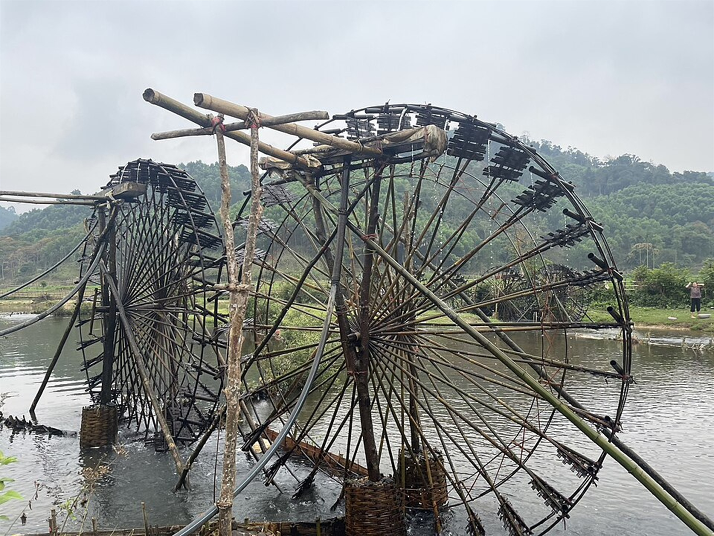

*Hình 3.1 — Cọn nước: công trình thủy lợi truyền thống tiêu biểu của đồng bào các dân tộc vùng Tây Bắc; là một trong những dạng công trình được số hóa trong nhóm lớp thủy lợi (ảnh thuộc bộ ảnh minh họa của dự án [25]).*

Kết quả số hóa nhóm này kết nối trực tiếp với bằng chứng khảo sát: 52,3% người trả lời tại Phù Yên vẫn sử dụng thủy lợi truyền thống và 72,3% từng huy động ngày công chung nạo vét, khơi thông [29] — nghĩa là dữ liệu công trình trên bản đồ trùng khớp với thực hành quản lý nước đang diễn ra.

### 3.1.3. Nông lịch và tri thức canh tác — kết quả đối chiếu, kiểm định nguồn

Nhóm nông lịch và sự kiện văn hóa được kiểm định theo nguyên tắc “một mốc thời gian — tối thiểu hai nguồn độc lập”. Bảng 3.3 tóm tắt các mốc đã được sửa hoặc xác nhận trong quá trình rà soát.

**Bảng 3.3. Kết quả kiểm định một số mốc nông lịch, sự kiện văn hóa**

| Nội dung | Giá trị đã kiểm định | Nguồn đối chiếu |
|---|---|---|
| Tết Mông (Nào Pê Chầu) | Tháng 12 – tháng 1 (cuối tháng 11 – đầu tháng 12 âm lịch) | [22] |
| Lễ hội Gầu Tào | Mùng 1 – rằm tháng Giêng âm lịch | [23] |
| Xên bản, Xên mường (người Thái) | Tháng 2 – tháng 3 | [23] |
| Thu hoạch thảo quả | Tháng 11 – tháng 12 | [19] |
| Gieo mạ, cấy lúa vụ xuân | Tháng 2 – tháng 3 | [18] |
| Tu sửa mương, phai | Tháng 1 – tháng 2 | [10], [11] |

Các mốc không tra được nguồn hoặc không thống nhất giữa các nguồn đã bị loại khỏi lớp hiển thị; lược đồ mặt cắt không gian sản xuất chỉ giữ các đai định tính có nguồn, bỏ các mốc độ cao không căn cứ được. Đây là minh họa cụ thể cho nguyên tắc của khung truy thực nguồn (mục 2.3.2).

### 3.1.4. Bản làng tiêu biểu và hồ sơ dân tộc

Nhóm bản làng gồm 25 bản gắn với văn hóa, tri thức đặc trưng; toàn bộ 25/25 bản có nguồn và đã được gắn mã hành chính của đơn vị hành chính sau sắp xếp [30]. Dữ liệu từng bản hiển thị trong bảng “Thông tin địa bàn” theo từng xã (ghép mã hành chính), kèm ảnh minh họa (giấy phép CC BY-SA/CC0 [25]), mô tả và nhóm dân tộc chủ đạo.

Bộ hồ sơ 18 dân tộc được xây dựng từ [2], [11] và đối chiếu báo chí; dữ liệu cơ cấu dân tộc theo đơn vị hành chính lấy từ [1], [5]. Quá trình rà soát đã sửa nhiều mô tả còn chung chung hoặc sai địa bàn sống chủ yếu (ví dụ: bổ sung địa bàn cụ thể của người Khơ Mú, người La Hủ, người Lự; sửa số liệu dân số người Mảng; chuẩn hóa ngôn ngữ người Mường là nhóm Việt–Mường) [30].

**Bảng 3.4. Tình trạng số hóa nhóm bản làng và dữ liệu dân tộc theo đơn vị hành chính**

| Nhóm dữ liệu | Quy mô | Mức truy thực nguồn | Ghi chú |
|---|---|---|---|
| Bản làng tiêu biểu | 25 bản | 25/25 có nguồn (100%) | Đã gắn mã hành chính đơn vị hành chính |
| Hồ sơ dân tộc | 18 dân tộc | Đối chiếu [2], [11] và báo chí | Mô tả viết lại theo nguồn |
| Cơ cấu dân tộc theo đơn vị hành chính | 75 đơn vị | Có số liệu [1], [5] | Tỷ lệ chi tiết theo đơn vị hiển thị kèm biểu đồ tròn |

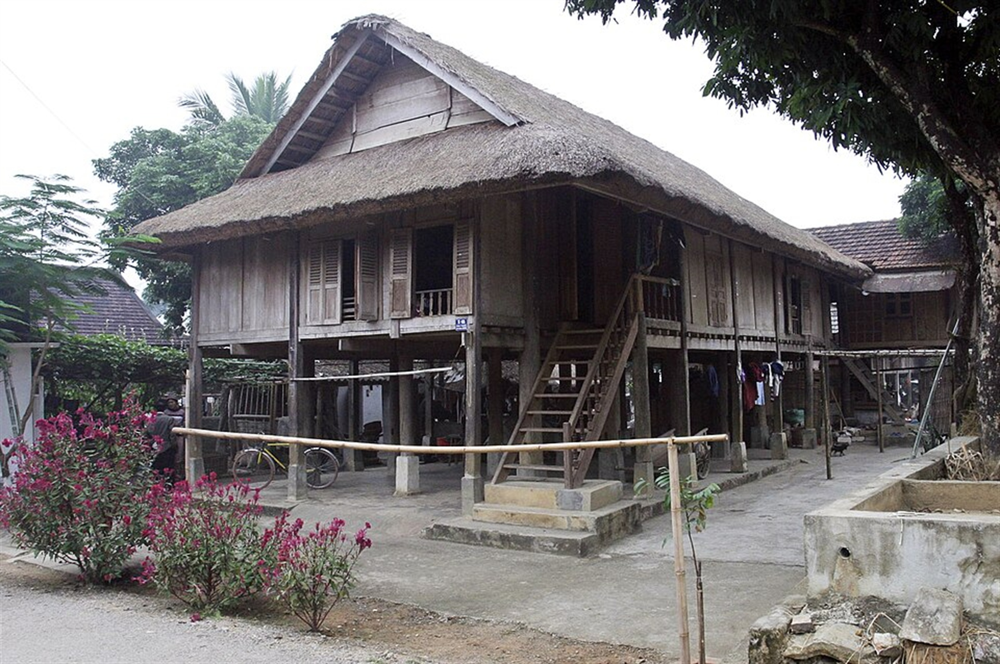

*Hình 3.2 — Nhà sàn người Thái: không gian ở truyền thống tiêu biểu, minh họa cho hồ sơ dân tộc và nhóm dữ liệu bản làng trong hệ thống (ảnh thuộc bộ ảnh minh họa của dự án [25]).*

### 3.1.5. Tồn kho và tình trạng truy thực nguồn sau rà soát

Bộ dữ liệu cuối cùng gồm 73 đối tượng thuộc 7 nhóm lớp; toàn bộ 73/73 đối tượng đều ở mức “có nguồn” sau khi trải qua nhiều vòng rà soát (cập nhật đến 16/10/2026). Trong quá trình rà soát, 11 đối tượng không còn tìm được tài liệu xác minh (gồm một số công trình thủy lợi, phai, mô hình VAC và vùng luật tục cụ thể) đã bị loại bỏ thay vì để tồn tại với mô tả không căn cứ [30].

Bảng 3.10 hệ thống hóa tồn kho theo từng nhóm lớp, làm rõ quy mô, hiện trạng truy thực nguồn, nguồn chính và mức ưu tiên cập nhật trong giai đoạn tiếp theo. Mức ưu tiên được xác định dựa trên hai tiêu chí: nhu cầu số hóa đo được từ khảo sát (đất, rừng, nước đạt mức đồng ý cao nhất [29]) và vai trò của nhóm dữ liệu trong các chuỗi kinh tế tuần hoàn (mục 3.2.4).

**Bảng 3.10. Tồn kho tri thức bản địa đã số hóa theo nhóm lớp**

| Loại tri thức | Số lượng / hiện trạng | Nguồn chính | Mức ưu tiên |
|---|---|---|---|
| Luật tục — vùng phong tục | 5 đối tượng; 100% ở mức có nguồn xác minh [30] | [12], [13], [18] | Cao — lớp nền đối chiếu giao đất, giao rừng, xử lý chồng lấn |
| Thủy lợi truyền thống và quản lý nước cộng đồng | 6 công trình/hệ thống; 100% có nguồn xác minh [30] | [10], [11], [14], [18] | Cao — gắn với nhóm nước (55,3% đồng ý số hóa [29]) và ngày công nạo vét |
| Nông lịch, sự kiện văn hóa và tri thức canh tác | 7 đối tượng (phần còn lại của tổng 73); các mốc đã kiểm định theo nguyên tắc hai nguồn độc lập | [10], [11], [19], [22], [23] | Trung bình — cần đối chiếu thêm theo từng bản khi mở rộng dữ liệu |
| Rừng và khu bảo tồn | 11 đối tượng (rừng tự nhiên theo tập quán và khu bảo tồn), đối chiếu WDPA [7] | [7], [12], [30] | Cao — phục vụ xử lý chồng lấn rừng giao và rừng theo tập quán (64,6% [29]) |
| Cây dược liệu và dược liệu dưới tán | 11 đối tượng (vùng và cây dược liệu tiêu biểu); phần không có nguồn thống nhất chuyển trạng thái chờ xác minh | [16], [30] | Trung bình — đầu vào chuỗi dược liệu và du lịch cộng đồng |
| Mô hình VAC/VACR | 8 đối tượng; 100% có nguồn xác minh [30] | [20], [21], [30] | Trung bình — đầu vào chuỗi kinh tế tuần hoàn nông thôn |
| Bản làng tiêu biểu | 25 bản; 25/25 có nguồn (100%), đã gắn mã hành chính [30] | [2], [11], [25] | Cao — đối tượng phục vụ dân cư, du lịch và giáo dục địa phương |

Kèm theo bộ 73 đối tượng là các lớp dữ liệu phục vụ: 18 hồ sơ dân tộc, cơ cấu dân tộc theo 75 đơn vị hành chính lấy từ [1], [5], cùng lớp nền hành chính, thủy văn và độ cao. Quy mô tồn kho tuy còn nhỏ so với tiềm năng 12 dân tộc của toàn tỉnh, nhưng đã bảo đảm hai tính chất mà các sáng kiến quốc tế còn thiếu (Chương 1, mục 1.2.1): tính truy thực nguồn tuyệt đối và tính gắn với đơn vị quản lý. Việc toàn bộ đối tượng còn lại đều ở trạng thái `co_nguon` sau khi loại bỏ 11 đối tượng không căn cứ cho thấy nguyên tắc “không tra được nguồn thì không đưa vào bản đồ” không chỉ là chủ trương mà đã được thực thi thành quy trình rà soát có kiểm soát.

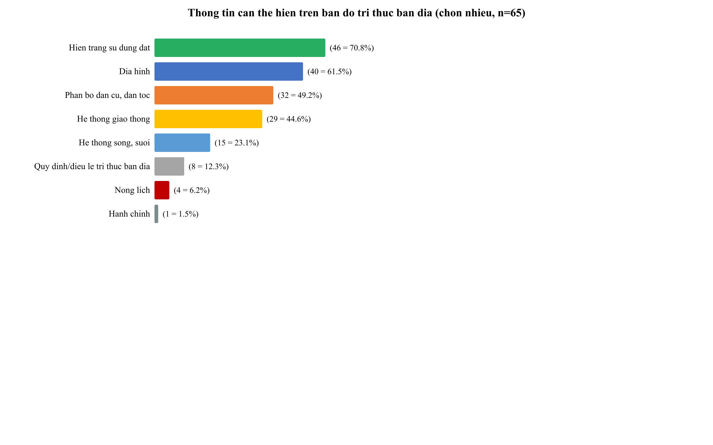

*Hình 3.3 — Tồn kho đối tượng theo 7 nhóm lớp dữ liệu: 73 đối tượng, 100% ở mức có nguồn xác minh [30].*

## 3.2. Kết quả bản đồ hóa tài nguyên thiên nhiên và các chuỗi kinh tế tuần hoàn

### 3.2.1. Rừng và khu bảo tồn

Nhóm rừng gồm 11 đối tượng (rừng tự nhiên theo tập quán và khu bảo tồn), đối chiếu với WDPA [7]; tiêu biểu: Vườn Quốc gia quanh đỉnh Fansipan (khoảng 28.500 ha, đa dạng sinh học cao nhất Đông Dương, nguồn dược liệu quý), Khu Bảo tồn thiên nhiên Hoàng Liên – Văn Bàn (khoảng 25.000 ha, bảo vệ các loài thú quý hiếm) [30]. Các đối tượng rừng theo tập quán (rừng cấm, rừng bảo vệ đầu nguồn theo luật tục) được hiển thị riêng lớp, ghi rõ nguồn từ tài liệu khoa học [12] hoặc quy ước cộng đồng.

### 3.2.2. Cây dược liệu và dược liệu dưới tán rừng

Nhóm dược liệu gồm 11 đối tượng (vùng và cây dược liệu tiêu biểu), gắn với chủ trương phát triển vùng dược liệu 16.145 ha của tỉnh [16].

**Bảng 3.5. Ví dụ đối tượng cây dược liệu trong dữ liệu**

| Đối tượng | Địa bàn / chú thích | Nguồn |
|---|---|---|
| Tam thất (Bắc Hà) | Cây dược liệu quý, cần bảo tồn | [16] |
| Atisô (Sa Pa) | Trồng quy mô, chuỗi giá trị nông – dược | [16] |
| Đắng sâm (Y Tý) | Cây thuốc vùng cao | [16] |
| Dược liệu dưới tán rừng (KBTTN Mường La) | Hơn 48 ha chu kỳ 1 | [16] |
| 8 đối tượng dược liệu khác | Hiển thị kèm nhãn nguồn | [30] |

Các nội dung về tình trạng bảo tồn của cây dược liệu không có nguồn thống nhất đã được chuyển sang trạng thái chờ xác minh thay vì hiển thị như thông tin đã kiểm chứng — đúng nguyên tắc đề tài đã đặt ra.

### 3.2.3. Mô hình VAC/VACR — kinh tế tuần hoàn tại địa phương

Nhóm mô hình VAC/VACR gồm 8 đối tượng, 100% có nguồn [30].

**Bảng 3.6. Mô hình VAC/VACR tiêu biểu trong dữ liệu**

| Mô hình | Thành phần vòng tuần hoàn | Địa bàn | Nguồn |
|---|---|---|---|
| VAC vùng cao (Phiêng Ban) | Vườn cây ăn quả + ao cá + chuồng lợn đen + rừng keo | Xã Bắc Yên (Phù Yên cũ), Sơn La | [30] |
| VAC + thảo quả Khun Há | Vườn cây ăn quả + ao cá + thảo quả dưới tán | Tam Đường, Lai Châu | [20] |
| VAC bản Tà Lọt | Vườn – ao – chuồng quy mô gia trại | Xã Tà Lại cũ (nay Đoàn Kết), Mộc Châu | [21] |
| VAC quy mô lớn (vườn chuối, sắn xen canh) | Vườn + ao cá chép + đàn vịt | Sơn La | [30] |

Mỗi mô hình hiển thị bằng biểu tượng riêng trên bản đồ, bấm vào để xem thành phần, thành phần kinh tế tuần hoàn và liên kết nguồn; các mô hình nằm trong hoặc gần vùng quy hoạch giúp chính quyền nhìn thấy khoảng trống cần bổ sung chuỗi.

### 3.2.4. Sáu chuỗi tri thức — tài nguyên — kinh tế tuần hoàn

Từ dữ liệu đã số hóa và bằng chứng khảo sát, đề tài hệ thống hóa 6 chuỗi kinh tế tuần hoàn tiêu biểu của tỉnh (Bảng 3.7).

**Bảng 3.7. Sáu chuỗi tri thức — tài nguyên — kinh tế tuần hoàn trên địa bàn tỉnh**

| STT | Chuỗi | Vòng tuần hoàn cốt lõi | Vai trò của tri thức bản địa |
|---|---|---|---|
| 1 | Lúa nước – ruộng bậc thang | Phế phẩm mùa vụ → phân chuồng/ủ rơm → đất → lúa | Mương – phai – lái – lìn điều tiết nước; luật tục điều tiết việc dùng nước [10], [11] |
| 2 | Thảm thực vật – thảo quả dưới tán | Rừng keo/tự nhiên → thảo quả dưới tán → thu hoạch tháng 11–12 | Tập quán canh tác dưới tán, luân canh [19] |
| 3 | Dược liệu dưới tán rừng | Rừng khoáng → dược liệu → sinh kế → giữ rừng | Tri thức cây thuốc của người Mông, Hà Nhì, Dao [16] |
| 4 | Chè Shan tuyết hữu cơ | Rừng chè cổ thụ → chế biến hữu cơ → xuất khẩu/OCOP | Bí quyết chế biến của người Tày Bản Liền [15] |
| 5 | VAC/VACR | Vườn – ao – chuồng – rừng khép kín, không rác thải | Kỹ thuật chăn nuôi lợn đen, trồng cây bản địa [20], [21] |
| 6 | Du lịch cộng đồng – văn hóa bản | 25 bản, 18 dân tộc, lễ hội → dịch vụ → quỹ bảo tồn văn hóa | Nông lịch, lễ hội, luật tục làm nội dung du lịch [22], [23] |

## 3.3. Hệ thống WebGIS xây dựng và kiểm chứng

### 3.3.1. Chức năng hệ thống

Hệ thống WebGIS đã xây dựng chạy hoàn toàn trên trình duyệt, không cần cài đặt, phù hợp với chính quyền cấp xã và người dùng phổ thông (Bảng 3.8).

**Bảng 3.8. Chức năng chính của hệ thống WebGIS**

| Chức năng | Mô tả | Người dùng chính |
|---|---|---|
| Tra cứu đơn vị hành chính | Tìm xã/tỉnh; bấm vào vùng để xem ranh giới, dân tộc, thông tin | Cán bộ, người dân |
| Hiển thị 7 nhóm dữ liệu | Bật/tắt lớp bản đồ theo chủ đề; tra cứu dữ liệu theo dạng Điểm/Đường/Vùng/Danh sách | Nhà quản lý |
| Bản đồ mật độ dân số | Thang màu liên tục theo 7 bậc người/km² tại cấp xã; tooltip và legend tự cập nhật | Quy hoạch, quản lý dân cư |
| Biểu đồ cơ cấu dân tộc | Biểu đồ tròn marker tại từng xã (chọn/xóa hàng loạt theo tỉnh); mục “Dân tộc khác” = phần bù 100% | Nhà quản lý, nghiên cứu |
| Chú giải thích ứng | Chú giải tự cập nhật theo khung nhìn và vùng chọn (tuân thủ QCVN 80 [6]) | Mọi người dùng |
| Thông tin đa chiều theo đơn vị hành chính | Panel địa bàn + banner ảnh dân tộc chủ đạo + biểu đồ cơ cấu dân tộc, tài nguyên, bản làng, luật tục | Cấp xã, huyện |
| Chế độ xem 3D | Quan sát địa hình theo chiều cao | Quy hoạch, giảng dạy |
| Biên tập và nhập dữ liệu | Cập nhật đối tượng; phê duyệt theo quy trình | Nhóm nghiên cứu, cộng tác viên |
| Xuất bản đồ A4/A3 | Bản đồ giấy kèm khung, chú giải ngoài khung, nguồn dữ liệu (Biên tập bản đồ) | Bản làng, nhà trường |

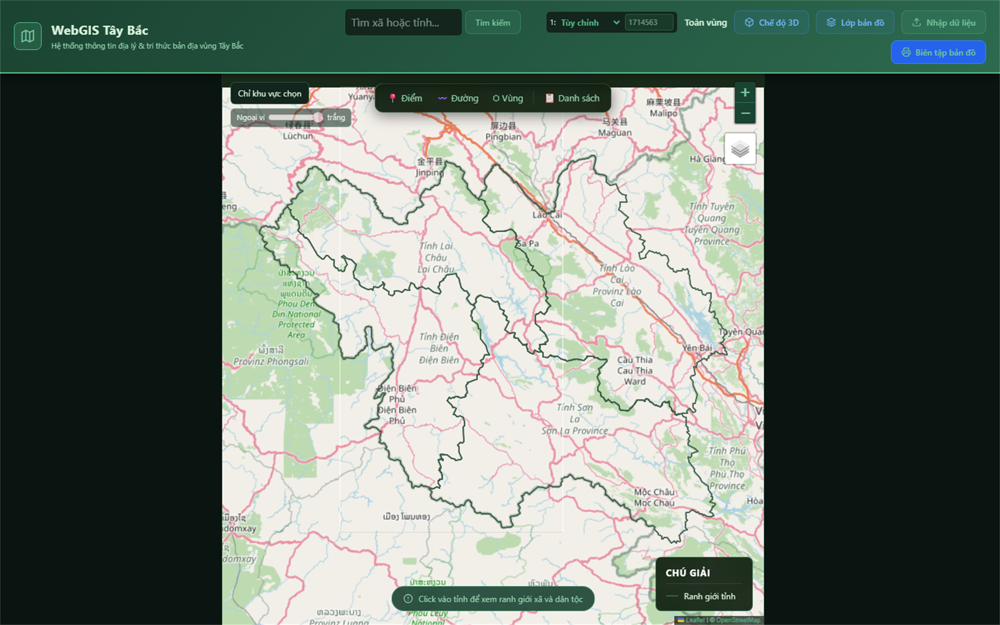

*Hình 3.4 — Giao diện chính của hệ thống WebGIS: thanh công cụ tìm kiếm, chọn vùng, chế độ 3D, lớp bản đồ, biên tập; bản đồ ranh giới đơn vị hành chính và chú giải thích ứng.*

### 3.3.2. Bản đồ mật độ dân số theo đơn vị hành chính

Lớp mật độ dân số là một trong những lớp nền quan trọng nhất của hệ thống, phục vụ trực tiếp yêu cầu “phân bố dân cư” mà 49,2% người trả lời khảo sát lựa chọn là nội dung ưu tiên hiển thị (mục 2.4.5) [29].

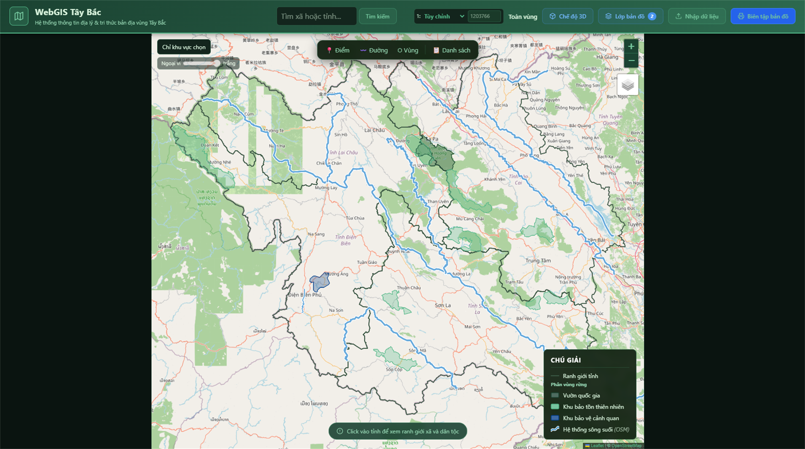

*Hình 3.5 — Tổng quan vùng Tây Bắc trên WebGIS: ranh giới 4 tỉnh sau sắp xếp đơn vị hành chính 01/7/2025 (Sơn La, Điện Biên, Lai Châu, Lào Cai) làm nền cho các lớp chuyên đề.*

Cơ chế hoạt động: khi người dùng chọn một tỉnh, hệ thống tự bật lớp mật độ dân số và vẽ các polygon cấp xã/phường theo thang màu liên tục 7 bậc (YlOrRd): dưới 50 · 50–100 · 100–200 · 200–500 · 500–1.000 · 1.000–2.000 · trên 2.000 người/km². Giá trị mật độ được tính từ số dân đã đối chiếu nguồn chính thống (Tổng điều tra dân số 2019 [1] và Cổng dữ liệu mở tỉnh Sơn La [5]) chia cho diện tích polygon hành chính. Khi bật “Chỉ khu vực chọn”, các xã ngoài vùng được mask trắng, lớp mật độ chỉ vẽ trong phạm vi chọn — bảo đảm bản đồ không hiển thị số liệu ngoài tỉnh đang xem.

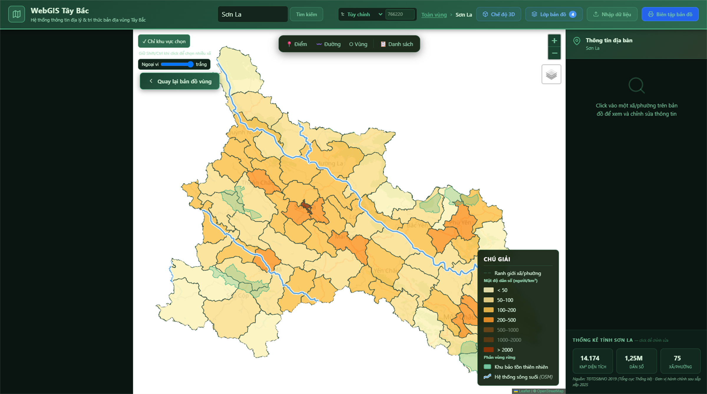

*Hình 3.6 — Bản đồ mật độ dân số cấp xã/phường tỉnh Sơn La: thang màu 7 bậc người/km², chú giải hiển thị đơn vị rõ ràng; các xã trung tâm TP Sơn La đạt bậc > 2.000, các xã vùng cao chủ yếu dưới 50–100.*

Đặc điểm kỹ thuật đáng chú ý: (i) lớp mật độ được đặt trong pane riêng (“density-pane”) để không che popup hay chú giải; (ii) khi hover, polygon tăng độ trong suốt và viền đậm lên để người dùng xác định nhanh xã đang xem; (iii) legend của lớp mật độ tham gia quy tắc chú giải thích ứng chung — ẩn đi khi không có polygon nào trong khung nhìn ∩ vùng chọn (mục 2.3.3). Kết hợp với lớp ranh giới hành chính, bản đồ mật độ cho phép cán bộ cấp xã nhìn ngay được các điểm tập trung dân cư — cơ sở bố trí dịch vụ công, quy hoạch điểm dân cư và định hướng phát triển kinh tế – xã hội.

### 3.3.3. Biểu đồ cơ cấu dân tộc theo phường, xã

Biểu đồ tròn cơ cấu dân tộc là lớp dữ liệu tương tác thứ hai được tích hợp ở cấp xã, thể hiện trực tiếp “kho tri thức bản địa” qua từng cộng đồng dân tộc (Chương 1, mục 1.1.1).

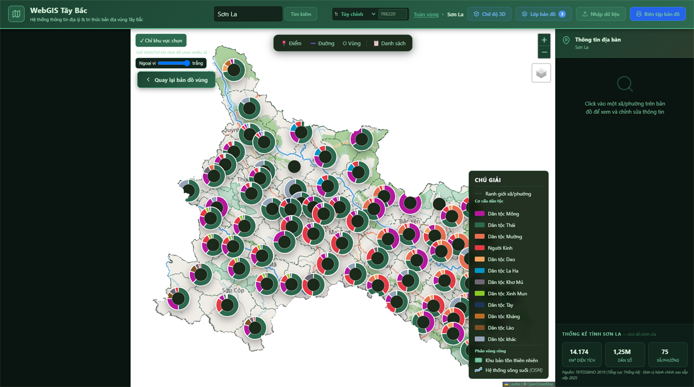

*Hình 3.7 — Biểu đồ cơ cấu dân tộc theo phường, xã trên WebGIS: mỗi marker là biểu đồ tròn với các lát cắt màu theo dân tộc; mục xám “Dân tộc khác” là phần bù 100% bằng phép trừ chính xác, không bịa số.*

Nguyên tắc dữ liệu: tỷ lệ dân tộc tại từng xã được lấy từ Cổng dữ liệu mở tỉnh Sơn La [5] và Tổng điều tra dân số 2019 [1]; khi nguồn chỉ nêu % dân tộc chủ đạo (không nêu đủ 100%), hệ thống tự động thêm lát cắt xám “Dân tộc khác” bằng phần bù `100 − tổng%` — phép trừ tuyệt đối, không phân bổ bịa số. Cơ chế này giải quyết triệt để lỗi thường gặp của biểu đồ tròn là bị “kéo” về 100% giả tạo, gây mâu thuẫn giữa hình vẽ và số liệu tooltip. Mỗi marker có tooltip hiển thị tên xã và danh sách % từng nhóm; người dùng có thể chọn/bỏ chọn hàng loạt xã theo tỉnh, hoặc giữ “Chỉ khu vực chọn” để chỉ vẽ trong vùng đang xem.

Về phía hiển thị, legend cơ cấu dân tộc tham gia quy tắc chú giải thích ứng: lát cắt và dòng chú giải chỉ xuất hiện khi có marker nằm trong khung nhìn ∩ vùng chọn; khi zoom đủ gần để còn một xã, legend tự rút gọn còn đúng nhóm dân tộc chủ đạo của các xã còn lại — tránh hiển thị hàng chục nhóm không có thực thể nào trên màn hình. Đây là minh họa cụ thể cho công thức quy tắc chú giải trình bày ở mục 2.3.3.

### 3.3.4. Ổn định và truy thực nguồn hiển thị

Cơ chế truy thực nguồn (mục 2.3.2) được hiện thực hóa trên giao diện qua hệ thống nhãn trạng thái và liên kết đối chiếu.

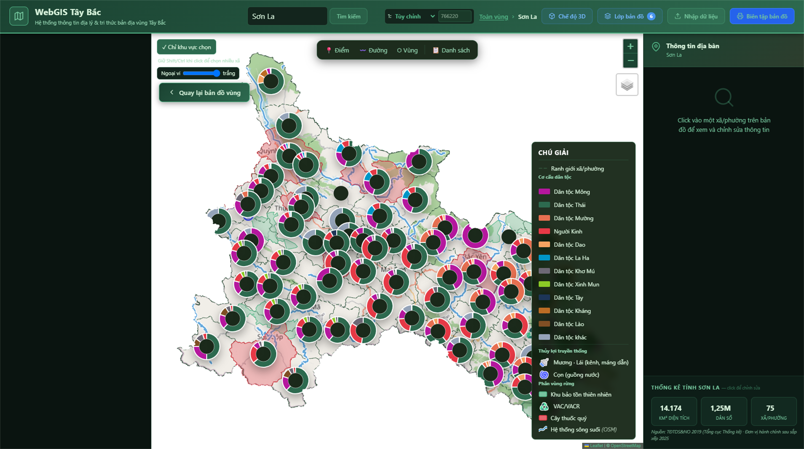

*Hình 3.8 — Hiển thị trạng thái nguồn trên popup đối tượng: nhãn màu (xám minh họa / vàng chưa xác minh / xanh lá có nguồn) kèm liên kết URL bấm được tới tài liệu gốc.*

Mỗi đối tượng dữ liệu khi được bấm vào sẽ hiển thị: mô tả, nhóm trạng thái (`co_nguon` / `mot_phan` / `du_doan` / `minh_hoa`) và danh sách liên kết nguồn dạng URL bấm được (mở tab mới). Quy tắc xuyên suốt “không tra được nguồn thì không đưa vào bản đồ” đã được thực thi qua nhiều vòng rà soát: vòng cập nhật 16/10/2026 đã loại bỏ 11 đối tượng không tìm được tài liệu xác minh và nâng 73/73 đối tượng còn lại lên trạng thái `co_nguon` [30] (xem Phụ lục A). Cơ chế guard tự kiểm tra localStorage cũng được bổ sung: nếu trình duyệt còn lưu bản dữ liệu cũ có nhãn `minh_hoa` / `chua_xac_minh`, hệ thống sẽ tự động loại bỏ và tải lại bản mới từ máy chủ — bảo đảm người dùng cuối luôn thấy dữ liệu đã kiểm định.

### 3.3.5. Xuất bản đồ giấy và thông tin địa bàn

Hai chức năng hoàn thiện vòng “dữ liệu → bản đồ → quản lý” được trình bày tại Hình 3.9 và Hình 3.10.

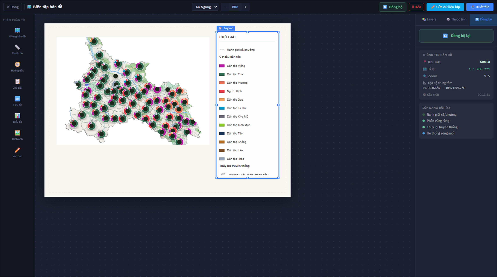

*Hình 3.9 — Chức năng Biên tập bản đồ: chọn khổ giấy A4/A3, dọc/ngang; khung bản đồ tự co theo tỉ lệ trang; chú giải đặt ngoài khung theo QCVN 80 [6]; nguồn dữ liệu và tỷ lệ hiển thị trên bản đồ in.*

Chức năng Biên tập bản đồ cho phép xuất bản đồ giấy A4/A3 theo cả bốn khổ (dọc/ngang × A4/A3). Khung bản đồ mặc định được thiết lập theo đúng tỉ lệ khổ giấy (62% × 62% hai chiều → tỉ lệ khung = tỉ lệ trang), tránh hiện tượng chọn A4 ngang nhưng khung gần vuông. Chú giải được đặt bên ngoài khung bản đồ — tuân thủ yêu cầu trình bày của QCVN 80 [6] — và tự động đồng bộ với các lớp đang bật ở giao diện chính. Khi đổi khổ giấy, toàn bộ phần tử (khung, chú giải, tiêu đề) được co giãn theo tỉ lệ trang mới, giữ nguyên bố cục tổng thể.

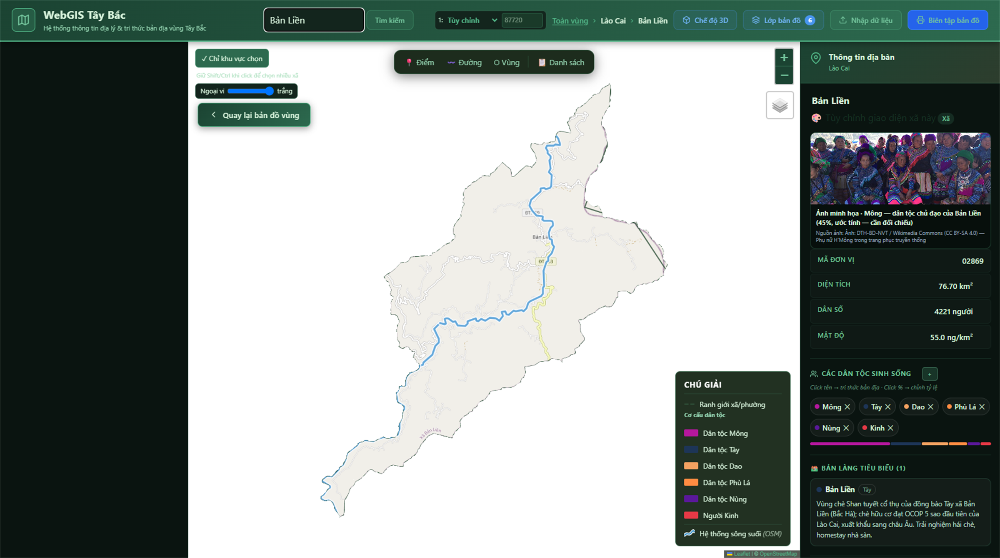

*Hình 3.10 — Bảng “Thông tin địa bàn” khi chọn xã: banner ảnh dân tộc chủ đạo, dòng nguồn dân số, khối “Đặc điểm địa bàn”, danh sách bản làng tiêu biểu và luật tục cộng đồng theo mã hành chính.*

Khi người dùng bấm vào một xã/phường, bảng “Thông tin địa bàn” hiển thị: (i) banner ảnh của dân tộc chủ đạo (lấy từ bộ ảnh Wikimedia Commons có giấy phép CC BY-SA/CC0 [25]); (ii) dòng nguồn dân số kèm số lượng đồng bào dân tộc thiểu số; (iii) khối “Đặc điểm địa bàn” với chip trạng thái nguồn; (iv) danh sách bản làng tiêu biểu và luật tục cộng đồng được ghép theo mã hành chính (`ma_xa`). Đây chính là điểm hội tụ của “số hóa ở trung tâm, sử dụng ở bản”: dữ liệu đã kiểm định được trình bày dưới dạng panel dễ đọc cho cán bộ xã và người dân, không yêu cầu kiến thức GIS.

### 3.3.6. Kết quả kiểm chứng

Hệ thống được kiểm chứng theo ba hướng: (i) **tuân thủ chuẩn**: chú giải, ký hiệu, khung bản đồ theo QCVN 80 [6]; (ii) **kiểm thử tự động**: các luồng chức năng chính (tải bản đồ, bật/tắt lớp, tra cứu đơn vị, xuất bản đồ) được kiểm thử đầu cuối bằng Playwright [28], toàn bộ kiểm thử đạt; (iii) **đối chiếu nguồn**: mỗi đối tượng bấm vào hiển thị trạng thái nguồn và liên kết đối chiếu. Chi tiết kịch bản và kết quả kiểm thử trình bày ở Phụ lục C.

Để người đọc thấy rõ quan hệ giữa yêu cầu đặt ra và kết quả đạt được, Bảng 3.11 đối chiếu từng chức năng chính của hệ thống với yêu cầu tương ứng — được rút từ lý luận (Chương 1), chuẩn kỹ thuật (QCVN 80 [6]) và nhu cầu đo được từ khảo sát [29] — cùng kết quả kiểm chứng cụ thể. Bảng này đóng vai trò bản đồ “dựng chiếu” giữa chương lý luận, chương kết quả và chương thảo luận hạn chế, giải pháp (Chương 4).

**Bảng 3.11. Đối chiếu yêu cầu chức năng và kết quả kiểm chứng WebGIS**

| Chức năng | Yêu cầu tương ứng | Kết quả kiểm chứng | Ghi chú |
|---|---|---|---|
| Tra cứu đơn vị hành chính | Cán bộ và người dân phải tìm được xã đang quan tâm và xem thông tin ranh giới, dân tộc mà không cần kiến thức GIS (Chương 1, mục 1.1.2) | Chức năng tìm kiếm và bấm chọn vùng hoạt động; popup hiển thị thông tin xã | Kiểm thử luồng tra cứu đạt [28] |
| Hiển thị 7 nhóm lớp tri thức — tài nguyên | Số hóa phải đưa được nội dung bản địa lên bản đồ theo chủ đề, bật/tắt được từng lớp (khoảng trống dữ liệu, Chương 1, mục 1.4) | 73/73 đối tượng thuộc 7 nhóm lớp hiển thị theo dạng Điểm/Đường/Vùng/Danh sách, 100% có nguồn [30] | Đối chiếu tồn kho tại Bảng 3.10 |
| Bản đồ mật độ dân số | 49,2% người trả lời chọn phân bố dân cư là nội dung ưu tiên hiển thị [29]; số liệu dân số phải có nguồn chính thống | Thang màu 7 bậc người/km² theo polygon cấp xã; số liệu từ [1], [5]; mask ngoài vùng chọn | Phục vụ quy hoạch điểm dân cư, bố trí dịch vụ công |
| Biểu đồ cơ cấu dân tộc | Hiển thị “kho tri thức bản địa” theo từng cộng đồng; không bịa số khi nguồn không nêu đủ [5] | Biểu đồ tròn marker tại từng xã; mục “Dân tộc khác” = phần bù 100% bằng phép trừ chính xác | Chọn/bỏ chọn hàng loạt theo tỉnh; legend rút gọn theo khung nhìn |
| Chú giải thích ứng theo QCVN 80 [6] | Chú giải giảm tải nhận thức, chỉ hiển thị phần liên quan tới khung nhìn và vùng chọn (Chương 1, mục 1.1.2) | Chú giải tự cập nhật theo khung nhìn ∩ vùng chọn; ẩn khi không có thực thể trong vùng | Tuân thủ trình bày chuẩn bản đồ quốc gia |
| Truy thực nguồn hiển thị | Người xem phải biết được mức độ tin cậy của từng đối tượng ngay trên bản đồ (Chương 1, mục 1.4) | Nhãn trạng thái nguồn và liên kết URL bấm được tới tài liệu gốc; guard localStorage loại bản dữ liệu cũ thiếu nguồn | Cơ chế khác biệt cốt lõi của đề tài |
| Thông tin địa bàn theo xã | Giao diện dễ đọc cho cán bộ cấp xã, không yêu cầu kiến thức GIS; dữ liệu liên kết theo mã hành chính | Panel địa bàn gồm banner ảnh dân tộc, nguồn dân số, bản làng, luật tục ghép theo `ma_xa` | Hội tụ “số hóa ở trung tâm, sử dụng ở bản” |
| Xuất bản đồ giấy A4/A3 | 75,4% người dân muốn dùng đồng thời bản đồ giấy và bản đồ số [29]; bản đồ in phải đúng chuẩn [6] | Bốn khổ A4/A3 dọc/ngang; chú giải đặt ngoài khung; nguồn dữ liệu và tỷ lệ hiển thị trên bản đồ in | Bàn giao trực tiếp cho bản làng, nhà trường |
| Chế độ xem 3D | Hỗ trợ quan sát địa hình (ruộng bậc thang, sườn núi) cho quy hoạch và giảng dạy | Chế độ 3D quan sát địa hình theo chiều cao | Hỗ trợ giáo dục địa phương |
| Biên tập và nhập dữ liệu | Bộ dữ liệu phải cập nhật, mở rộng được theo từng đơn vị hành chính (Chương 1, mục 1.2.1) | Chức năng cập nhật đối tượng kèm quy trình phê duyệt | Điều kiện để mô hình “cập nhật định kỳ” khả thi |

Như vậy, toàn bộ chức năng nêu trong Bảng 3.8 đều đã được đối chiếu ngược với một yêu cầu cụ thể và đều có kết quả kiểm chứng tương ứng. Điểm quan trọng không phải là số lượng chức năng mà là mọi chức năng đều phục vụ một nhu cầu đã được đo lường hoặc một chuẩn đã được quy định — đúng nguyên tắc “phù hợp với mục đích sử dụng” đặt ra ở Chương 1, và là cơ sở để Chương 4 đề xuất các giải pháp hoàn thiện trên đúng các mắt xích này.

## 3.4. Kết quả khảo sát thực địa — bằng chứng thực chứng

Khảo sát 65 phiếu tại huyện Phù Yên (cũ) [29] được xử lý thành các biểu đồ dưới đây, phân tích theo bốn nhóm nội dung. Số liệu được xử lý bằng phần mềm thống kê PSPP; các bảng tổng hợp tính trên giá trị hợp lệ của từng biến (giá trị thiếu được loại riêng và ghi rõ khi cần) — do đó tỷ lệ trong phần kết quả có thể được tính trên mẫu 65 phiếu hoặc trên mẫu hợp lệ nhỏ hơn, và bảng nào dùng mẫu hợp lệ nhỏ hơn đều được ghi chú rõ. Toàn bộ số liệu trích dẫn trong chương này lấy từ bộ kết quả xử lý khảo sát [29] và đối chiếu với các số liệu đã nêu ở Chương 1, Chương 2.

**Bảng 3.12. Tổng hợp số liệu khảo sát chính (n = 65 phiếu, huyện Phù Yên cũ)**

| Nhóm nội dung | Chỉ tiêu | Kết quả | Ghi chú |
|---|---|---|---|
| Đặc điểm dân tộc | Thái 43,1%; Mường 43,1%; Mông 13,8% | 65/65 phiếu có trả lời | 100% người trả lời là dân tộc bản địa |
| Đặc điểm giới tính | Nam 60,0%; Nữ 40,0% | 65/65 phiếu hợp lệ | — |
| Thời gian sinh sống | Trên 15 năm: 71,4% (hợp lệ); 5–15 năm: 23,8% | n = 63 phiếu hợp lệ, 2 phiếu thiếu | Tỷ lệ người gắn bó lâu năm cao — điều kiện cho khảo sát tri thức bản địa |
| Trình độ học vấn | THCS 46,2%; THPT 35,4%; tiểu học 7,7%; chưa qua đào tạo 6,2%; trung cấp trở lên 4,6% | 65/65 phiếu hợp lệ | Giao diện bản đồ phải đơn giản, ít chữ chuyên môn |
| Hoạt động tạo thu nhập chính | Công nhân/viên chức Nhà nước 44,6%; nông nghiệp 32,3%; khác 12,3%; lâm nghiệp 4,6% | 65/65 phiếu hợp lệ | Mẫu gồm vừa nhóm hành chính, vừa nhóm sản xuất |
| Tham gia quản lý đất | Đang tham gia thường xuyên 41,3% (hợp lệ); từng tham gia nhưng đã ngừng 58,7% | n = 63 phiếu hợp lệ | Nhóm từng tham gia là nguồn dữ liệu thực hành dồi dào |
| Lý do ngừng sử dụng đất | Thiếu nhân lực 70,3%; chuyển đổi mục đích theo quy hoạch 16,2%; đất bạc màu 10,8% | n = 37 phiếu trả lời nhóm đã ngừng | Biến lao động là nguyên nhân chủ đạo |
| Nguồn biện pháp quản lý, cải tạo đất | Tri thức truyền thống, luật tục 87,7% | Như đã phân tích tại Hình 3.12 | Vượt xa hướng dẫn của Nhà nước (6,2%) |
| Mức cần số hóa — đất | Cần thiết 90,6% + rất cần thiết 3,1% = 93,7% (hợp lệ); bình thường 6,3% | n = 64 phiếu hợp lệ | Cao nhất trong ba nhóm tài nguyên |
| Mức cần số hóa — rừng | Cần thiết 66,2% + rất cần thiết 13,8% = 80,0%; bình thường 10,8%; không cần thiết 9,2% | 65/65 phiếu hợp lệ | — |
| Mức cần số hóa — nước | Cần thiết 41,5% + rất cần thiết 13,8% = 55,3%; bình thường 40,0%; hoàn toàn không cần thiết 4,6% | 65/65 phiếu hợp lệ | Cần truyền thông thêm về giá trị bản đồ nguồn nước |
| Phân loại rừng theo tập quán | Có: 92,3% | 65/65 phiếu hợp lệ | Xác nhận phân loại rừng theo phong tục còn được thực hành |
| Ghi hương ước, quy ước | Có: 83,1% | 65/65 phiếu hợp lệ | Hương ước là kênh thể chế hóa luật tục |
| Rừng giao/khoán trùng rừng thiêng, rừng bản | Có: 64,6% | 65/65 phiếu hợp lệ | Căn cứ cho lớp đối chiếu chồng lấn trên WebGIS |
| Thu hoạch sản phẩm rừng | Có: 89,2% | 65/65 phiếu hợp lệ | Lâm sản phi gỗ là sinh kế phổ biến |
| Giúp cây rừng tự phục hồi | Có: 96,8% (hợp lệ) | n = 62 phiếu hợp lệ | Nhận thức bảo vệ rừng cao |
| Hình thức bản đồ mong muốn | Cả hai (giấy + app): 75,4% (hợp lệ); chỉ bản đồ giấy: 11,5%; chỉ app: 9,8%; không có nhu cầu: 3,3% | n = 61 phiếu hợp lệ | Cơ sở cho giải pháp “WebGIS + xuất bản đồ giấy” |
| Mức độ sẵn sàng dùng bản đồ | Sẵn sàng dùng khi cần 75,8% + sẵn sàng dùng thường xuyên 22,6% = 98,4% (hợp lệ) | n = 62 phiếu hợp lệ | Chỉ 1,6% không có nhu cầu |
| Quan hệ dân tộc × hình thức bản đồ | người Mông 83,3% chọn bản đồ giấy treo nhà văn hóa; người Thái 85,2% và người Mường 78,6% chọn cả hai | χ² = 37,51; df = 6; p < 0,001; Cramer's V = 0,55 (n = 61) | Mối liên hệ mạnh giữa dân tộc và hình thức bản đồ ưa thích |

Bảng trên làm rõ cấu trúc mẫu trước khi đi vào phân tích chuyên đề: mẫu có tỷ lệ người gắn bó lâu năm với địa bàn cao (71,4% trên 15 năm), trình độ học vấn phổ biến là THCS – THPT (81,6% cộng lại) và cơ cấu dân tộc cân bằng giữa hai nhóm lớn nhất (Thái, Mường) — đủ để so sánh chéo mà vẫn bảo đảm tính đại diện cục bộ của huyện Phù Yên.

### 3.4.1. Đặc điểm mẫu và nguồn biện pháp quản lý đất

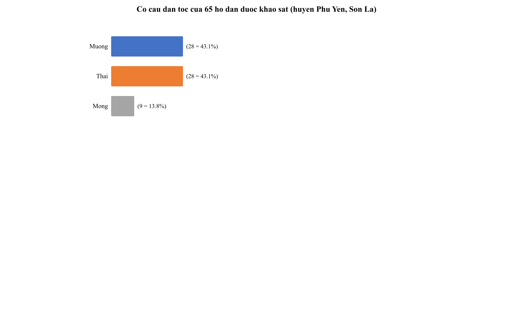

*Hình 3.11 — Cơ cấu dân tộc của 65 người trả lời: Mường và Thái mỗi nhóm chiếm 43,1%, Mông 13,8% [29].*

Mẫu bảo đảm hai điều kiện cho khảo sát tri thức bản địa: người dân tộc bản địa chiếm đa số (100% trả lời là Mường, Thái hoặc Mông) và tỷ lệ người sinh sống lâu năm cao (71,4% trên 15 năm) [29].

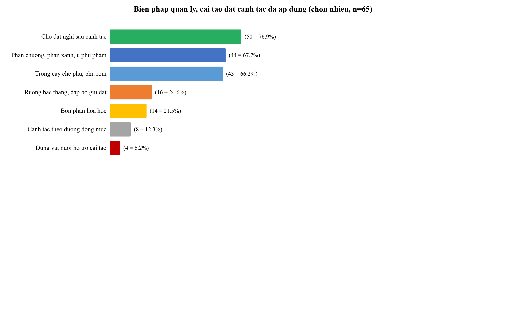

*Hình 3.12 — Nguồn gốc biện pháp quản lý, cải tạo đất canh tác: 87,7% xuất phát từ tri thức truyền thống, luật tục [29].*

Đây là kết quả then chốt: nhóm biện pháp hiệu quả nhất mà người dân đánh giá (phân chuồng 70,8%, cây che phủ 67,7%, cho đất nghỉ 55,4%) chính là nhóm biện pháp truyền thống — và nguồn học hỏi số một là “tri thức truyền thống (cha ông, luật tục)” (87,7%), vượt xa hướng dẫn của Nhà nước (6,2%) [29]. Bản đồ tri thức bản địa vì vậy không phải dữ liệu “trang trí văn hóa” mà là bản đồ của chính phương thức quản lý đất đang vận hành.

Bổ sung cho bức tranh này là cấu trúc học vấn và nghề nghiệp của mẫu: 46,2% trình độ THCS và 35,4% trình độ THPT, chỉ 4,6% có trình độ trung cấp trở lên [29]. Hàm ý thiết kế rất trực tiếp: giao diện bản đồ phải dùng ngôn ngữ gần gũi, ít thuật ngữ chuyên môn, thao tác ít bước; phần mô tả đối tượng cần viết theo kiểu “một câu một ý”, có thể đọc được trên điện thoại. Đồng thời, 44,6% người trả lời là công nhân hoặc viên chức Nhà nước và 32,3% làm nông nghiệp [29] — nghĩa là người dùng cuối của hệ thống đồng thời gồm cán bộ cơ quan (cần tra cứu tổng hợp, xuất bản đồ) và người sản xuất trực tiếp (cần xem thông tin bản làng, nguồn nước, rừng). Hai nhóm này có nhu cầu khác nhau nhưng dùng chung một nền tảng, do đó thiết kế “một hệ thống – nhiều mức độ chi tiết” (bản đồ số cho cán bộ, bản đồ giấy và panel đơn giản cho người dân) không phải là lựa chọn thẩm mỹ mà là yêu cầu bắt buộc từ cấu trúc mẫu. Về phía thực hành quản lý đất, 41,3% người trả lời đang tham gia quản lý đất thường xuyên và 58,7% từng tham gia nhưng hiện đã ngừng (giá trị hợp lệ, n = 63) [29]; nhóm thứ hai tuy không còn tham gia nhưng vẫn giữ kinh nghiệm thực hành — đây chính lực lượng “nguồn cung tri thức” quan trọng nhất cho quá trình số hóa, và cũng là nhóm dễ bị bỏ sót nếu chỉ khảo sát những người đang hoạt động tích cực.

### 3.4.2. Nguy cơ mai mốt tri thức bản địa

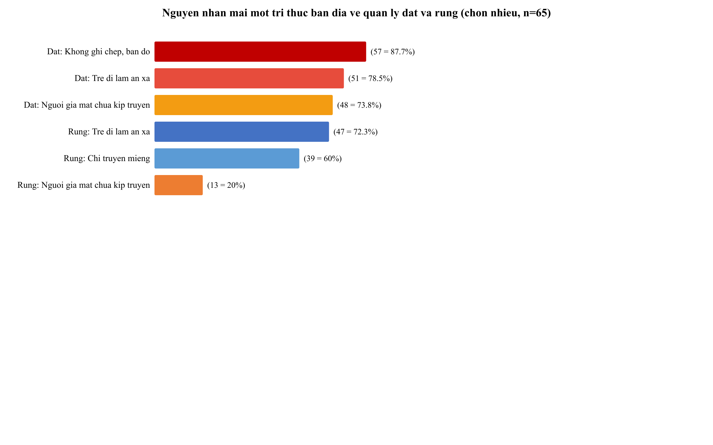

*Hình 3.13 — Nguyên nhân mai mốt tri thức bản địa theo từng nhóm tài nguyên [29].*

Ba nhóm nguyên nhân xuyên ngành: thiếu ghi chép/bản đồ (87,7% ở nhóm đất), biến đổi lao động (lớp trẻ đi xa: 72,3–78,5%) và sự thay đổi trong quản trị công (phụ thuộc công trình hiện đại: 81,5% ở nhóm nước). Đáng chú ý, 64,6% người trả lời cho biết rừng do Nhà nước giao/khoán trùng với rừng thiêng, rừng ma, rừng bản [29] — xung đột dữ liệu chỉ có thể gỡ khi hai hệ quy tắc được số hóa trên cùng một nền tảng.

Phân tích sâu hơn nhóm nguyên nhân thứ hai cho thấy mai mốt tri thức gắn liền với đứt gãy dòng truyền dạy thế hệ, không chỉ là vấn đề “người già nhớ ít”. Câu hỏi về lý do ngừng sử dụng đất (chỉ hỏi nhóm đã ngừng, n = 37) chỉ ra rằng 70,3% ngừng vì thiếu nhân lực, 16,2% vì chuyển đổi mục đích theo quy hoạch và 10,8% vì đất bạc màu xói mòn nặng [29] — tức là phần lớn việc rời khỏi đồng ruộng xuất phát từ biến đổi kinh tế – lao động chứ không từ suy giảm giá trị của tri thức canh tác. Hệ quả kép: một mặt, khi người trẻ đi xa, kênh truyền khẩu tự nhiên bị cắt đứt; mặt khác, khi đất bị chuyển đổi hoặc bạc màu, “thực địa mẫu” mà tri thức gắn vào không còn tồn tại — mất cả tri thức lẫn không gian chứa đựng tri thức đó. Đây chính là lý do việc số hóa và không gian hóa (gắn tri thức với tọa độ, ranh giới, đơn vị hành chính) cấp thiết hơn cả ghi chép chữ thuần túy: câu chuyện có thể được kể lại, nhưng ranh ruộng, mương nước và cách phân chia từng phần một khi bị san lấp thì không thể khôi phục chỉ bằng lời kể.

### 3.4.3. Mức độ cần thiết của số hóa

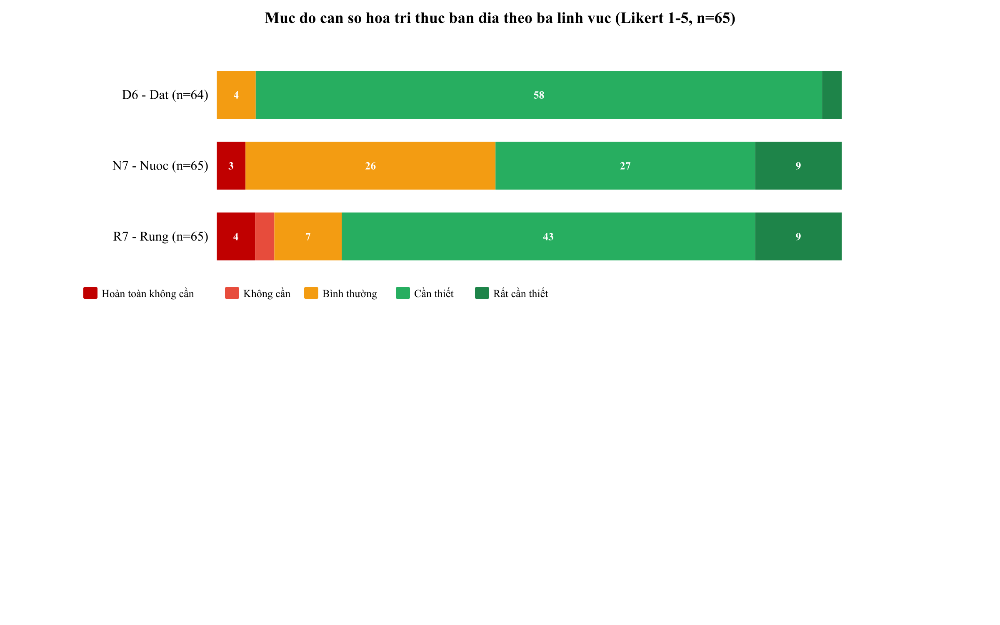

*Hình 3.14 — Điểm trung bình mức cần thiết số hóa bản đồ: Đất 3,97; Rừng 3,78; Nước 3,60 (thang 5 mức) [29].*

Tỷ lệ chọn “cần thiết” hoặc “rất cần thiết”: đất 93,7%, rừng 80,0%, nước 55,3% [29]. Mức đồng ý với nhóm nước thấp hơn không phải vì thiếu nhu cầu mà do nhóm nước có tới 40,0% chọn “bình thường” — cho thấy cần bổ sung truyền thông về giá trị của bản đồ nguồn nước khi triển khai.

So sánh thứ hạng ba nhóm với thực trạng quản lý tương ứng cho một mâu thuẫn hữu ích. Nhóm đất đạt đồng ý số hóa cao nhất (93,7%) nhưng cũng là nhóm có tỷ lệ “thiếu ghi chép/bản đồ” cao nhất (87,7%) và tỷ lệ mai mốt tri thức do biến đổi lao động cao (72,3%) — tức là nhu cầu tỷ lệ thuận với mức độ khẩn cấp. Nhóm nước ngược lại: tỷ lệ đồng ý số hóa thấp nhất (55,3%) nhưng nguy cơ mai mốt do phụ thuộc công trình hiện đại lại cao nhất (81,5%) và có tới 90,8% người trả lời nêu quy định của Nhà nước là hình thức bảo vệ nguồn nước chính (mục 1.1.4) — cho thấy người dân có xu hướng coi nguồn nước là “việc của công trình và chính quyền” hơn là “việc của tri thức cộng đồng”. Khoảng cách nhận thức này hàm ý rằng khi triển khai ở giai đoạn tiếp theo, lớp dữ liệu nguồn nước không nên chỉ trình bày “kỹ thuật” mà phải trình bày cả “thể chế”: công trình nào, dòng suối nào thuộc phạm vi bản nào, lịch chia nước ra sao — khi đó giá trị bản đồ nguồn nước mới rõ với người dân. Thứ tự ưu tiên nội dung do đó nên là: triển khai mạnh nhóm đất và rừng (nhu cầu cao, bằng chứng phong phú), đồng thời đi kèm truyền thông cụ thể cho nhóm nước thay vì coi mức đồng ý 55,3% là rào cản.

### 3.4.4. Hình thức bản đồ và mô hình quản lý

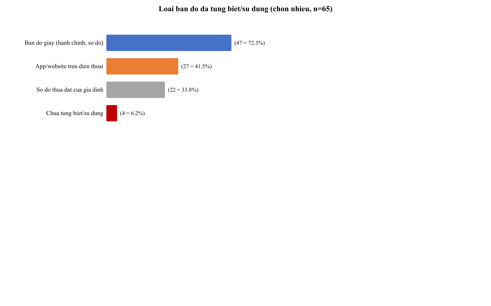

*Hình 3.15 — Hình thức bản đồ mong muốn: 75,4% chọn cả bản đồ giấy và ứng dụng điện thoại [29].*

Kết quả này là cơ sở để hệ thống cùng lúc cung cấp bản đồ số (WebGIS) và chức năng xuất bản đồ giấy A4/A3 (mục 3.3.1). Cùng đó, 73,8% người trả lời đề nghị trưởng bản/người có uy tín quản lý bản đồ [29] — mô hình quản lý “trưởng bản quyết định nội dung, phần mềm xử lý kỹ thuật, nhà nước bảo trợ dữ liệu”.

Phân tích chéo mở ra một phát hiện quan trọng cho cách triển khai theo từng địa bàn. Khi đối chiếu biến dân tộc với hình thức bản đồ mong muốn (n = 61 phiếu hợp lệ), sự khác biệt giữa các nhóm là rất mạnh: kiểm định Chi bình phương Pearson cho giá trị 37,51 với 6 bậc tự do, mức ý nghĩa nhỏ hơn 0,001, và hệ số Cramer's V = 0,55 — thuộc nhóm tương quan mạnh theo các ngưỡng diễn giải thông dụng. Cụ thể, nhóm người Mông trong mẫu lựa chọn gần như tuyệt đối bản đồ giấy treo tại nhà văn hóa bản (83,3%); trong khi người Thái (85,2%) và người Mường (78,6%) chủ yếu chọn hình thức kết hợp cả giấy lẫn ứng dụng điện thoại; riêng người Mường có thêm 14,3% chọn thuần ứng dụng. Một kiểm định tương tự giữa dân tộc và hiện tượng rừng giao khoán trùng rừng thiêng không cho thấy liên hệ có ý nghĩa thống kê (χ² = 3,00; df = 2; p = 0,223), nghĩa là xung đột ranh rừng xuất hiện tương đối đồng đều giữa ba dân tộc trong mẫu — không phải hiện tượng riêng của một nhóm. Ngược lại, liên hệ giữa giới tính và dân tộc trong mẫu là không đáng kể (χ² = 2,57; df = 2; p = 0,277), cho thấy mẫu không bị lệch giới tính theo từng dân tộc, nhờ đó so sánh chéo giữa các nhóm dân tộc không bị nhiễu bởi cấu trúc giới.

Hàm ý của các kết quả trên cho vận hành hệ thống là cụ thể. Thứ nhất, mô hình “một bản đồ cho tất cả” là không phù hợp: ở các bản có đông đồng bào Mông, ưu tiên đầu tư là bản đồ giấy cỡ lớn treo tại nhà văn hóa bản, còn bản đồ số chủ yếu dành cho cán bộ xã; ở bản người Thái, người Mường, có thể đẩy mạnh song song cả hai hình thức. Thứ hai, vì hiện tượng chồng lấn ranh rừng không phân biệt dân tộc, lớp dữ liệu đối chiếu rừng giao và rừng theo tập quán nên được ưu tiên triển khai đồng bộ trên toàn huyện thay vì thử nghiệm riêng lẻ theo khu dân tộc. Thứ ba, mô hình quản trị do người dân đề xuất (trưởng bản quản lý nội dung) càng có cơ sở khi kết hợp với đặc điểm văn hóa của từng nhóm: người Mông vốn quen với bản đồ treo tập trung ở không gian cộng đồng, nơi trưởng bản là người phát ngôn tự nhiên nhất.

## 3.5. Đánh giá mức độ sẵn sàng của nền tảng dữ liệu

Đánh giá mức độ sẵn sàng được thực hiện theo hướng ghép nối hai nguồn bằng chứng: kết quả xây dựng, kiểm định hệ thống (cung) và kết quả khảo sát thực địa (cầu). Bảng 3.9 tóm tắt các tiêu chí then chốt; Bảng 3.13 đi sâu hơn bằng cách mô tả từng tiêu chí, mức đạt được và ghi chú giải thích — trong đó mức đạt được hoặc rút trực tiếp từ số liệu đã trình bày ở các mục trên hoặc là nhận định định tính có căn cứ.

**Bảng 3.9. Tổng hợp mức độ sẵn sàng phục vụ quản lý tài nguyên và kinh tế tuần hoàn**

| Tiêu chí | Kết quả | Đánh giá |
|---|---|---|
| Tồn kho dữ liệu | 73/73 đối tượng có nguồn (100%) [30] | Đạt — minh bạch nguồn |
| Nhu cầu số hóa | Đất 93,7%; rừng 80,0%; nước 55,3% [29] | Cao — đặc biệt nhóm đất, rừng |
| Nhu cầu sử dụng bản đồ | 98,4% sẵn sàng sử dụng; 75,4% muốn cả giấy và app [29] | Rất cao |
| Mô hình quản lý | 73,8% đề nghị trưởng bản/người uy tín quản lý [29] | Rõ ràng, khả thi |
| Nội dung ưu tiên hiển thị | Hiện trạng đất 70,8%; địa hình 61,5%; phân bố dân cư 49,2% [29] | Đã có đủ lớp dữ liệu |
| Kỹ thuật hệ thống | WebGIS chạy được, kiểm thử đạt, xuất bản đồ chuẩn [6], [28] | Đạt |

**Nhận xét:** về phía cung (dữ liệu, công cụ) và phía cầu (nhu cầu, mô hình quản lý của người dân), nền tảng đã sẵn sàng để đưa vào thử nghiệm ở cấp xã. Khoảng cách còn lại nằm ở nhóm nước (mức đồng ý số hóa 55,3%) và ở tỷ lệ dự đoán trong dữ liệu dân tộc chi tiết theo đơn vị hành chính — cần bổ sung trong giai đoạn tiếp theo.

**Bảng 3.13. Tiêu chí đánh giá mức độ sẵn sàng của nền tảng dữ liệu**

| Tiêu chí | Mô tả | Mức đạt | Ghi chú |
|---|---|---|---|
| Tồn kho và minh bạch nguồn | Bộ dữ liệu tri thức bản địa đã số hóa, mọi đối tượng truy được nguồn gốc | Cao — 73/73 đối tượng có nguồn xác minh (100%) [30]; 11 đối tượng không căn cứ đã loại bỏ | Điều kiện tiên quyết để chính quyền dùng dữ liệu làm căn cứ |
| Độ phủ nhóm nội dung then chốt | Lớp dữ liệu bao phủ các nhóm tài nguyên mà người dân ưu tiên (đất, rừng, nước, dân cư) | Đã có lớp cho cả bốn nhóm ưu tiên; bản làng và luật tục đã gắn mã hành chính | Lớp chi tiết cho từng bản còn mỏng so với số bản thực tế của tỉnh |
| Nhu cầu số hóa đo được | Tỷ lệ người dân cho rằng cần thiết/rất cần thiết số hóa theo nhóm tài nguyên | Đất 93,7%; rừng 80,0%; nước 55,3% [29] | Nhóm nước cần truyền thông bổ sung khi triển khai |
| Nhu cầu và hình thức sử dụng | Mức độ sẵn sàng dùng bản đồ và hình thức ưa thích | 98,4% sẵn sàng dùng; 75,4% muốn cả giấy và app [29] | Hệ thống có cả WebGIS lẫn xuất bản đồ giấy A4/A3 |
| Mô hình quản trị bản địa | Người dân đề xuất ai quản lý nội dung bản đồ | 73,8% đề nghị trưởng bản/người có uy tín [29] | Phù hợp với thể chế truyền thống “người phân chia nước, người gác rừng” |
| Nội dung ưu tiên hiển thị | Các lớp người dân muốn thấy trên bản đồ | Hiện trạng đất 70,8%; địa hình 61,5%; dân cư 49,2% [29] | Đã có lớp dữ liệu nền và lớp chuyên đề tương ứng |
| Kỹ thuật và chuẩn trình bày | Hệ thống chạy ổn định, xuất bản đúng chuẩn, kiểm thử đạt | WebGIS hoạt động; kiểm thử Playwright đạt; xuất bản đồ theo QCVN 80 [6], [28] | Sẵn sàng cho thử nghiệm ở cấp xã |
| Nhận thức về thể chế rừng | Mức độ phân loại rừng theo tập quán và ghi hương ước còn sống | 92,3% phân loại theo tập quán; 83,1% ghi hương ước [29] | Dữ liệu hương ước là nguồn bổ sung ổn định cho lớp luật tục |
| Khoảng cách còn lại | Các nội dung chưa đạt mức sẵn sàng cao | Nhóm nước (55,3%); một phần dữ liệu dân tộc chi tiết còn mức dự đoán | Ưu tiên bổ sung trong giai đoạn tiếp theo (Chương 4) |

Tổng hợp lại, đánh giá mức độ sẵn sàng cho thấy nền tảng dữ liệu đã vượt qua ngưỡng “sẵn sàng thử nghiệm” nhưng chưa ở ngưỡng “sẵn sàng phổ rộng toàn tỉnh”. Ba trụ cột đã đủ — (1) bộ dữ liệu 73 đối tượng kiểm định nguồn, (2) hệ thống WebGIS chạy ổn định kèm xuất bản đồ chuẩn và (3) bằng chứng nhu cầu từ khảo sát — tạo thành một vòng khép kín “dữ liệu – công cụ – người dùng” mà các sáng kiến quốc tế từng thiếu (mục 1.2.1). Hai việc cần làm ngay trong giai đoạn tới là bù đắp chiều sâu cho nhóm nước (vừa bổ sung đối tượng, vừa thay đổi cách trình bày để người dân thấy giá trị bản đồ nguồn nước) và nâng cấp dữ liệu dân tộc theo đơn vị hành chính từ mức dự đoán lên mức có nguồn xác minh. Khi hai việc này hoàn tất, nền tảng có đủ điều kiện để chuyển từ thử nghiệm ở một huyện sang mở rộng theo các đơn vị hành chính còn lại của tỉnh — đúng định hướng mở rộng vùng đã đặt ra ở mục 1.5.2 và các giải pháp cụ thể sẽ được đề xuất ở Chương 4.
